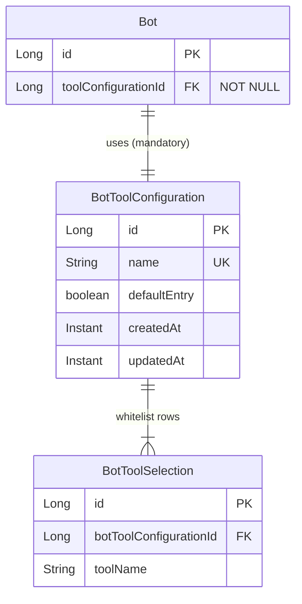
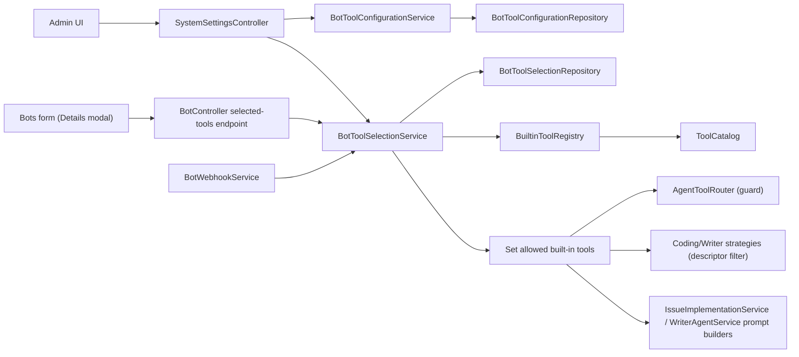

# Bot Tool Configurations

This document describes how to restrict the built-in agent tools available to a
bot via reusable **Tool configurations**, how the runtime enforces those
whitelists, and how the feature interacts with MCP tools and the legacy
prompt-based tool calling.

## Scope

- **Built-in tools** only. The catalog is the single source of truth at
  `org.remus.giteabot.agent.tools.ToolCatalog` (file tools, context tools,
  repository tools, validation tools).
- **MCP tools** are *not* part of a tool configuration; they continue to be
  managed via **System settings → MCP configurations** and per-server tool
  selection.
- Both native function-calling and the legacy prompt-based tool listing honor
  the whitelist.

## Why per-bot tool configurations?

A single instance often hosts bots with very different responsibilities. A
Java/Maven coding bot has no use for `npm`, `dotnet`, or `cargo`; a writer bot
must never see file-mutation tools. Without filtering, every bot would advertise
every tool to the LLM, which:

- wastes context (every descriptor is included in every request),
- invites the model to pick wrong tools (e.g. running `npm test` on a Maven
  project), and
- enlarges the surface for prompt-injection or accidental side effects.

Tool configurations let operators **opt bots into** the subset of built-in
tools they actually need.

## Data model

- `BotToolConfiguration` is a named, reusable whitelist of built-in tools.
- `BotToolSelection` rows are the enabled tool names (whitelist semantics —
  a missing row means the tool is **disabled** for any bot using this
  configuration).
- `Bot.toolConfigurationId` is a **mandatory** foreign key. Every bot is always
  associated with exactly one tool configuration.

## The Default configuration

The Default configuration is **created by the Flyway migration V12** together
with its full set of statically known built-in tool selections, so it exists
and is usable the moment the application opens the database. There is no
runtime bootstrap component: the application never auto-extends the Default
configuration. This means:

- Migration correctness is self-contained: V12 inserts the Default row,
  seeds the built-in tool selections (file, context, repository) and then
  attaches every existing bot to it before adding the `NOT NULL` /
  foreign-key constraint.
- New built-in tools shipped in a later release are added to Default by
  follow-up migrations (V29 seeded `ctags-signatures` / `ctags-deps` and V37
  `pr-diff`, both CONTEXT). Validation tools added through
  `agent.validation.available-tools` and any other built-in tools are
  **not** added to Default automatically — an admin opts in by editing the
  configuration in **System settings → Tool configurations**.
- Admin-curated selections in Default and in every other configuration are
  stable across upgrades.

The Default configuration is protected:

- It **cannot be renamed**.
- It **cannot be deleted**.
- Its selection is everything the migrations shipped with that release seed —
  it grows through new migrations, never at boot.

A tool configuration referenced by at least one bot cannot be deleted either —
the service rejects the request with a clear error and the UI surfaces it.

## Managing tool configurations in the UI

Open **System settings → Tool configurations**.

### Create / clone

1. Click **Add** to create a new configuration, or **Clone** next to an
   existing one to copy its name and selection.
2. Pick a descriptive name (for example *Java/Maven*, *Node.js*, *Writer-only*).
3. Click **Save and select tools**.

### Select tools

The tool-selection screen mirrors the MCP whitelist UX:

- rows grouped by **Kind** (FILE, CONTEXT, REPOSITORY, VALIDATION),
- free-text filter,
- kind filter,
- sortable columns (name, kind, description),
- page size + paging,
- per-row checkbox plus **select all visible** in the table header.

Click **Save** to persist. Only the checked rows become `BotToolSelection`
entries; everything else is rejected at runtime.

### Open tool selection later

- **System settings → Tool configurations → Tools**
- **Edit tool configuration → Select tools**

## Assigning a tool configuration to a bot

Open **Bots → New Bot** or **Edit Bot**. The form has a mandatory
**Tool configuration** dropdown. Use **Details** next to the dropdown to open a
read-only modal listing the currently selected built-in tools, grouped by kind.
Newly created bots default to the **Default** configuration.

## Runtime enforcement

The whitelist is enforced in three independent layers so a misbehaving model
cannot bypass it:

1. **Native function-calling surface.**
   `ToolCatalog.nativeDescriptors(role, mcpCatalog, allowedBuiltinTools)`
   filters built-in descriptors so disabled tools are never advertised to the
   provider's function-calling API. MCP tools pass through unchanged.
2. **Legacy prompt-based tool listing.**
   `IssueImplementationService.buildToolsInfo()` and
   `WriterAgentService.outputContract()` only emit names that survive the
   whitelist filter. If an operator disabled every built-in writer tool, the
   prompt explicitly says so.
3. **Router guard.**
   `AgentToolRouter.execute(...)` checks every incoming tool call before
   dispatch. Built-in calls that are not on the whitelist are rejected with
   a `ToolResult` whose error message tells the model that the tool is
   disabled for this bot. MCP tools are exempt — they are governed by
   `McpToolSelectionService`.
4. **Prompt tool-selection strategy.** Each agent stage's system prompt carries
   a "when to reach for it" line for every tool that survives the whitelist
   *and* belongs to that stage's role — the hint is read from the tool's own
   definition (`ToolCatalog.usageHint`) and rendered by
   `SystemPromptAssembler` into the stage's native protocol. A tool the bot
   cannot call is never described, so the strategy cannot drift from the
   selection.

### Validation tools

Validation tools come from `agent.validation.available-tools` (see
[Agent Documentation](AGENT.md)). They are listed in the tool-selection screen
with kind **VALIDATION** and obey the same whitelist semantics. Like every
built-in tool added after V12 they are **not** seeded into the Default
configuration (see [The Default configuration](#the-default-configuration) above), so an
admin enables the ones the bot's repositories actually need — a bot whose projects
use Maven does not want the agent trying `gradle` or `cargo`.

The list also ships **`execute`**, which runs a validation script committed
inside the repository instead of an external binary — the escape hatch for
documentation-only, CI/CD and infrastructure repositories without a
conventional build command. It takes the script's repository-relative path as
its single argument and treats exit code `0` as success; the path is resolved
against the checkout, so nothing outside the repository can be configured. It only
runs the script as committed — a script the current run has edited is refused, so
the agent cannot rewrite its own checker. Existing installations have to opt in to
`execute` by hand: it is not part of the Default configuration. See
[Coding Agent → Custom validation scripts](CODING_AGENT.md#custom-validation-scripts-execute).

The list also ships **`yarn`**, separately from **`npm`**, so a bot for Yarn
repositories can enable one and leave the other off. The tool layer detects the
package manager of each checkout and refuses `npm` when the repository is Yarn-managed
(`packageManager` in `package.json`, `yarn.lock`, a committed `yarnPath`) — a prompt
instruction alone would not stop an `npm install` from writing a `package-lock.json`.
Symmetric to that, `yarn` is refused in an npm-managed or unmarked checkout, where it
would create a `yarn.lock`; one manager runs per checkout. `yarn` activates the
project's pinned version through Corepack, or runs the committed `yarnPath` release. See
[Coding Agent → Yarn projects](CODING_AGENT.md#yarn-projects-yarn).

### Backwards compatibility

`null` as the whitelist disables enforcement entirely. This path is used by
tests and the pre-1.7 code paths; production bots always carry a non-null
whitelist derived from their `BotToolConfiguration`.

## Migration from earlier versions

Flyway migrations `V11__bot_tool_configurations.sql` and
`V12__bot_tool_configuration_fk.sql` ship the schema and a fully
self-contained, two-step bootstrap that does **not** depend on any
application-level code:

1. **V11** creates `bot_tool_configurations` + `bot_tool_selections` and adds
   a nullable `bots.bot_tool_configuration_id` column.
2. **V12** inserts the Default configuration row, seeds it with every
   statically known built-in tool (file, context, repository — and the silent
   context aliases), backfills every existing bot to that Default
   configuration, adds the foreign-key constraint and finally sets the column
   to `NOT NULL`.
3. **V29** adds the `ctags-signatures` / `ctags-deps` context tools and
   **V37** adds the `pr-diff` context tool to the Default configuration, so
   fresh installations and existing Default configurations expose every
   context-gathering tool. (V30 separately backfills `pr-diff` into custom
   configurations used by bots with the agentic-review workflow.)
4. `execute-code` is **not** in the Default configuration — not from the migrations, and not
   from the startup extension described below. Its sandbox
   confines neither the filesystem nor the network. Where the deployment names a
   sandbox pool (the shipped image does) the program runs as one of its
   identities, one per execution, so it reads neither the service user's files nor
   this JVM's start-time environment (`/proc/<jvm-pid>/environ`) — and, because no
   two runs share an identity, it cannot read a concurrent run's program, answer
   on its bridge socket or signal its process; where no pool is named it runs as
   the service user and reads whatever that user reads
   (`open("/absolute/path")`, `$HOME`). Either way it reaches the network
   (`subprocess`, `os.system`, `curl`; the import guard blocks the names it knows,
   and a program that wants out does not use them).
   Enabling it is therefore an operator's decision, made per bot. What a program
   may *call* is the tools the run offers it: repository reads plus the bot's
   selected MCP tools, never a built-in write, the branch switch or a build. An
   MCP tool is free to act outside the bot (open an issue, post a comment), and
   such a call is not counted as a round — MCP is a mutable surface the read-only
   round accounting cannot see. `execute-code` and the read-only catalogue
   tools reach a PR-workflow run (readme-sync, i18n-coverage, unit-test-author,
   e2e) the same way they reach the coding, writer and agentic-review runs:
   only once the bot selects them in its tool configuration — a workflow run
   restores neither a `rg` an operator removed nor an `execute-code` it never
   opted into. The deployment still decides whether a sandbox exists at all.
   Network isolation, on top of the uid separation, is what would make a
   different default defensible.

Once the migrations have run, `DefaultToolSetInitializer` extends the Default row on every
start: it adds each built-in tool the running build ships that the row does not select yet, so
a bot that references Default gains a newly shipped tool on upgrade instead of silently losing
it. `execute-code` is the exception (`BotToolConfigurationService.OPT_IN_TOOLS`) — the Default
row cannot be edited afterwards, so a tool that landed in it would be permanent and opt-out for
every bot that never attached a configuration of its own. A bot gets code execution only from a
configuration that selects it.

Tool configurations an admin creates are never touched by this: a tool removed there stays
removed, and a narrower configuration stays narrow.

There is nothing for operators to do on upgrade — existing bots continue to
expose all built-in tools (because they reference Default), `execute-code`
except, and admins can later create narrower configurations and reassign
individual bots.

## Component view

## See also

- [User Guide — Managing Bots](USER_GUIDE.md#managing-bots)
- [MCP Server Handling](MCP_SERVER_HANDLING.md)
- [Agent Documentation](AGENT.md)
- [Tool Calling](TOOL_CALLING.md)

