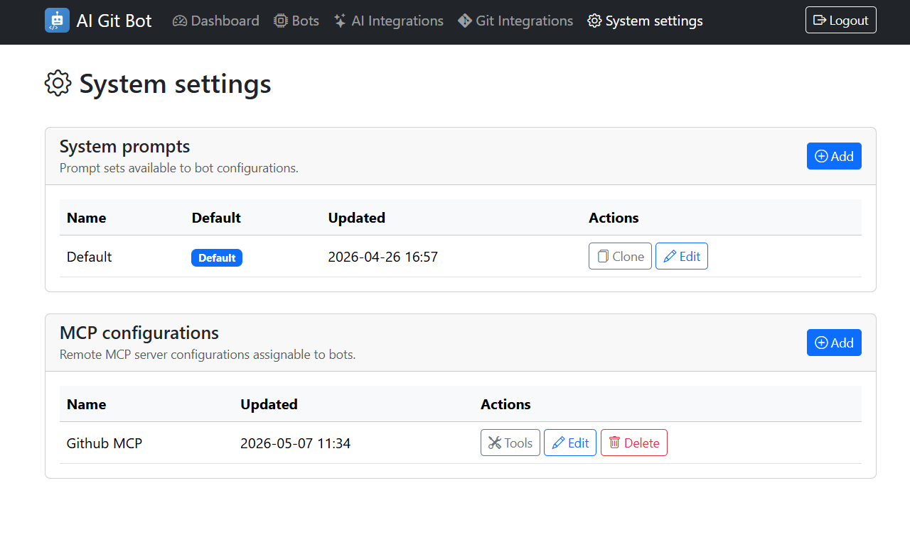
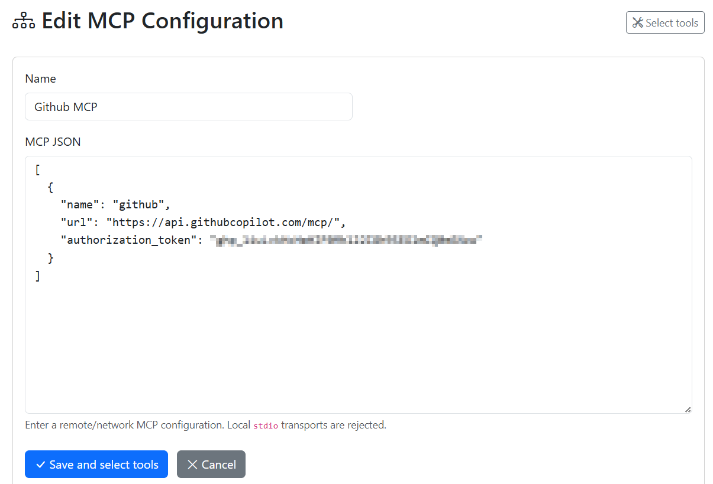
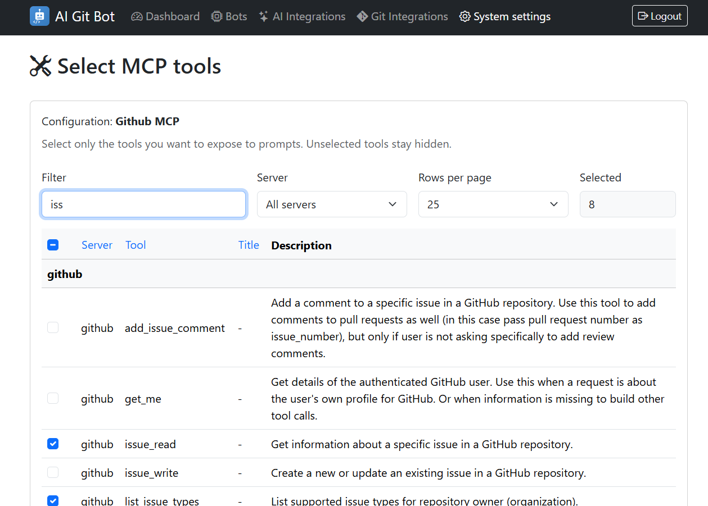
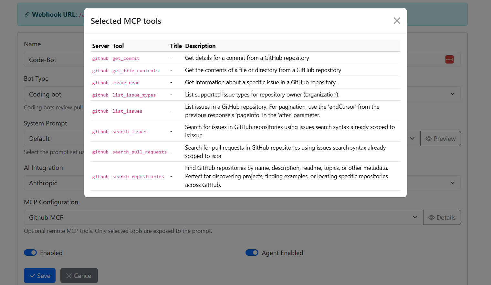
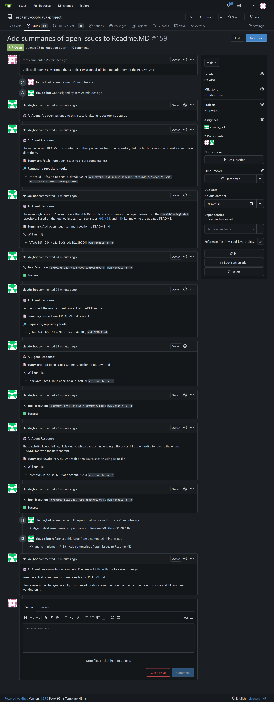

# MCP Server Handling

This document describes how MCP servers are configured, how tool whitelisting works, where selected tools are shown in bot configuration, and how MCP calls are made transparent during issue implementation.

## Scope

- MCP servers are configured in **System settings → MCP configurations**.
- Only remote transports are supported (HTTP/HTTPS/WS/WSS/SSE).
- Local `stdio` MCP transport is intentionally rejected.



## 1) Create or Edit an MCP Configuration

1. Open **System settings → MCP configurations**.
2. Click **Add** or **Edit**.
3. Fill in:
   - **Name**
   - **MCP JSON** (remote server definitions)
4. Click **Save and select tools**.

   

After save, the application validates the JSON and discovers tools from all configured MCP servers.

### Example JSON

```json
[
  {
    "name": "github",
    "type": "url",
    "url": "https://api.githubcopilot.com/mcp/",
    "authorization_token": "<token>"
  }
]
```

You can also use object-style server definitions (for example with `mcpServers`) as long as remote endpoints are configured.

### Secret References in the MCP JSON

Credentials in the MCP JSON do not have to be written into the configuration itself. `authorization_token` (including its `authorizationToken` / `token` aliases) and every `headers` value accept a [secret reference](SECRET_REFERENCES.md), which is resolved each time a request to the MCP server is made:

```json
[
  {
    "name": "github",
    "type": "url",
    "url": "https://api.githubcopilot.com/mcp/",
    "authorization_token": "${env:GITHUB_MCP_TOKEN}",
    "headers": {"X-Api-Key": "${env:MY_API_KEY}"}
  }
]
```

With `${env:...}`, the environment variable must be listed in `GITEABOT_SECRET_ENV_WHITELIST` before it can be read; nothing is readable by default. Escaping (`$${env:NAME}`), mixing references with literal text (`"Bearer ${env:TOKEN}"`), what happens when a reference cannot be resolved, the reserved variable names, and how to add further secret sources are all described in [Secret References](SECRET_REFERENCES.md) — the mechanism is not MCP-specific.

MCP-specific detail: only `authorization_token` and `headers` values are resolved. The `url` field does **not** support secret references, because MCP endpoints are logged for diagnostics.

## 2) Select MCP Tools (Whitelist)

After saving an MCP configuration, the tool-selection page opens automatically.

You can also open it any time without changing JSON:

- **System settings → MCP configurations → Tools**
- **Edit MCP configuration → Select tools**

The table supports:

- filtering by text
- server filter
- sorting by server/tool/title
- paging and configurable page size
- per-row checkbox selection
- **select all visible** in the table header

Only selected tools are persisted and appended to agent system prompts.

Unselected tools remain hidden from the AI agent.



### Read-only approval for the new review protocol (configuration only)

The separate **Read-only approval (new review protocol)** checkbox is an explicit
ADMIN trust decision. Selection, **select all visible**, descriptions and server
`readOnlyHint` annotations never grant approval. Existing selections start
unapproved. Only selected, currently discoverable tools can be approved; an
unchecked approval revokes it. Filtering, paging and saving an unchanged selection
preserve the independent approval state. The form submits explicit grant/revoke
edits, not existing checked rows as new grants, so an old form cannot silently
restore invalidated trust after a configuration change and revert.

Approval is bound to the configuration ID, qualified/server/tool names, a SHA-256
of the discovered tool definition (including its input schema and descriptive
metadata), and a SHA-256 of the configuration ID plus its server-owned opaque
approval revision. Each configuration has an independent random UUID revision;
no fingerprint of decrypted credentials is persisted or exposed. A semantic
configured-JSON change rotates that revision and clears approvals atomically,
including endpoint, header, token or reference changes. JSON object key order,
formatting and name-only edits preserve the revision; changing and reverting the
JSON does not restore an old revision. Resolved runtime secret values and remote
server implementation changes are not inferred from configuration. An observed
changed or unavailable definition is not approved. Reapproval requires a fresh
form and an explicit checkbox; submitted revision/proof metadata is not trusted.

`McpToolSelectionService.readReviewReadOnlyApprovals(observedConfiguration, catalog)`
returns immutable identity/schema/configuration-hash evidence only for selected,
approved entries matching that catalog and the current stored configuration.
It does not discover tools, freeze a run, or authorize execution. Its caller must
provide a sufficiently fresh trusted catalog and freeze/verify the matching actual
definitions and configuration for the run. Those runtime requirements belong to
RR07B, together with descriptor/dispatch enforcement and run fencing.
The admin form uses `loadSelectionSnapshot` so displayed rows and server-held
evidence come from the same catalog/configuration read; request fields contain
only names, explicit edits and a session-bound nonce, not proof hashes.
Discovery uses a detached configuration capture **before** any row lock. Then
replacement, validation/invalidation, configuration saves and deletion serialize
on the same configuration row, refresh persisted state, and reject a configuration
revision that changed during discovery. No configuration/protocol lock spans MCP
discovery. This prevents an ordinary stale selection save from undoing a committed
revocation. The public read seam requires the configuration captured for its
catalog, rather than pairing an old catalog with whichever configuration is now
stored. Runtime callers still own catalog freshness and per-run freezing.

**This configuration feature does not activate the new protocol. LEGACY0 and
current legacy routes are unchanged and do not enforce this new approval.**

The H2 and PostgreSQL `V63__review_mcp_read_only_approval.sql` files are provisional.
Release is blocked (Draft) until the central V59 (#468) → V60 (#474) → V61 (control)
→ V62 (completion) → V63 sequence is integrated and qualified. Isolated development
tests are not qualification of an actual V60/V62 production upgrade; no missing
migrations are copied or bypassed with `outOfOrder`.

## 3) View Selected Tools in Bot Configuration

In **Bots → New/Edit**, next to the MCP configuration dropdown, use **Details**.

The details dialog shows a read-only list of the selected tools for that MCP configuration:

- server
- tool name
- title
- description

This is based on the persisted whitelist selection.




## 4) How Prompt Exposure Works

At runtime, the application discovers MCP tools and then applies the persisted whitelist before rendering MCP tool entries into prompts.

Result: the agent only sees and can call whitelisted MCP tools.

## 5) Transparency of MCP Calls During Issue Work

### Current behavior

- MCP tool calls are executed by the issue/writer agent loop.
- MCP tools are handled as silent tools (same category as internal context/file tools).
- Issue comments are not spammed with per-call MCP request/response payloads.

### What is visible in issue comments

- high-level agent progress/comments
- validation command feedback (where applicable)

### Where to inspect exact MCP call behavior

Use application logs for detailed MCP transparency:

- transport/connection attempts
- initialization/discovery diagnostics
- MCP tool execution failures

This keeps issue threads readable while still allowing technical traceability in logs.

<details>
<summary>📸 Screenshots: MCP-Tool selection transparency in Issue-comments</summary>

**Gitea:**


</details>


## 6) Exposing Deployment-Style Tools

The bot can use any MCP server as a *deployment
target* — the `MCPDeploymentStrategy` lets a PR workflow trigger, observe
and tear down per-PR preview environments by calling regular MCP tools on
an already configured server.

> **Why would I want this?** See
> [`doc/agentic-workflows/MCP_DEPLOYMENT_USER_STORY.md`](agentic-workflows/MCP_DEPLOYMENT_USER_STORY.md)
> for a concrete persona-driven story + benefits matrix, and
> [`systemtest/README-mcp-deployment.md`](../systemtest/README-mcp-deployment.md)
> for a 2-minute laptop reproduction (`docker compose -f
> systemtest/docker-compose-mcp-deployment.yml up --build`).

### Expected tool shape

You expose **up to three** tools on the MCP server. Their qualified names
are configured per deployment target (see
[doc/PR_WORKFLOWS.md → Deployment targets](PR_WORKFLOWS.md#deployment-targets-m3)):

| Role          | Required | Receives                                                                 | Returns (JSON)                                                                                          |
|---------------|----------|--------------------------------------------------------------------------|----------------------------------------------------------------------------------------------------------|
| `deployTool`   | yes      | the rendered `argsTemplate` (see below)                                  | `{ "previewUrl": "..." }` → `READY`, or `{ "handle": {...} }` → `PENDING`, or `{ "status": "failed", "error": "..." }` |
| `statusTool`   | optional | `{ runId, prNumber, repoOwner, repoName, handle }`                       | same shape as `deployTool` — used by the bot's poller to upgrade `PENDING` → `READY` / `FAILED`         |
| `teardownTool` | optional | `{ runId, prNumber, repoOwner, repoName, handle }`                       | any (bot only inspects success)                                                                          |

Argument payload available to `deployTool` (placeholders are substituted in
the operator-defined `argsTemplate`; if `argsTemplate` is omitted, the bot
sends a flat envelope with all of these keys):

| Placeholder         | Example value                                                  |
|---------------------|----------------------------------------------------------------|
| `{prNumber}`        | `1234`                                                          |
| `{sha}`             | `deadbeefcafe…`                                                 |
| `{branch}`          | `feature/x`                                                     |
| `{repoOwner}`       | `acme`                                                          |
| `{repoName}`        | `web`                                                           |
| `{runId}`           | `42` (persistent `PrWorkflowRun.id`)                            |
| `{callbackUrl}`     | `https://bot.acme.io/api/workflow-callback/42/<callbackSecret>` |
| `{callbackSecret}`  | per-run secret — useful if you eventually want to POST back     |

### Whitelisting

All three tool names **must** be ticked in **System settings → MCP
configurations → Tools** before the deployment target can be saved:

- the admin-UI save handler calls `McpToolSelectionService.selectedQualifiedToolNameSet(id)`
  and rejects the form otherwise (`HTTP 400` with an actionable message);
- the strategy enforces the same check a second time at runtime, so
  removing a tool from the whitelist after the fact safely degrades to a
  `REJECTED` deployment instead of a silent execution.

### Polling, not callbacks

`MCPDeploymentStrategy.awaitsCallback() == false` — MCP servers do not
deliver HTTP callbacks into the bot. After `trigger()` returns `PENDING`,
the bot's scheduled `DeploymentPoller` invokes `statusTool` at the target's
configured interval (`timeoutSeconds` is the upper bound) until it
observes `READY` / `FAILED`. The operator never has to wire up an inbound
HMAC endpoint for an MCP-backed target.

### When to choose MCP vs. WEBHOOK

| Choose `MCP` when…                                                | Choose `WEBHOOK` when…                                       |
|-------------------------------------------------------------------|--------------------------------------------------------------|
| You already operate an internal platform MCP server.              | Your deploy lives in Jenkins / CI directly.                  |
| You want everything (tool whitelist, audit) under one MCP roof.   | You need a callback channel because deploy is fire-and-forget. |
| Your deploy/status flow is naturally request/response.            | The CI side cannot easily call out to an MCP server.         |
