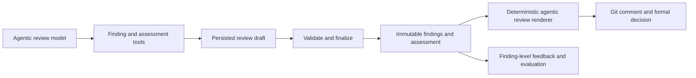

# Agentic review: structured output, human feedback, and learning implementation plan

## 1. Baseline and intended result

Prepared on **2026-11-11** against remote `develop` commit
**`3858a41ec9bb0e9419a60ca099757ce9d5c0005a`**
(`Merge pull request #553 from sarankumar1325/fix/545-plan-comment-read-only-rounds`).
The remote head was verified with `git ls-remote origin refs/heads/develop`.
The local `develop` ref was behind at `c3e7a4e7`; the implementation inspection
used an archive of the verified remote commit, not the checked-out feature branch.
Recheck these integration points when starting each implementation PR.
Scope revised on **2026-11-14**; the inspected implementation baseline remains
the commit above.

**Outcome:** in `agentic-review`, the model creates findings and an overall
assessment through dedicated tools. AI-Git-Bot persists those records and renders
every completed agentic review with the same application-owned structure and
formatting. A developer can then assess an individual finding, the assessment,
or the review inside the Git UI. The bot derives candidate lessons, validates
them, and provides relevant active lessons to later agentic-review runs. Users
can inspect and disable lessons through Git comments. Each change remains
attributable and reversible.

**Scope:** every implementation step, including optional extensions, applies
only to `agentic-review`. The normal `review` workflow remains the inexpensive,
tool-free alternative: preserve its prompts, AI request flow and call count,
diff chunking, text output, follow-ups, and formal decisions. It receives no
submission tools, structured-output requirement, feedback instrumentation, or
learned context. Unit/E2E tests, documentation, translations, and issue workflows
are also outside this plan. Shared infrastructure changes must preserve these
existing workflow behaviors, including when one bot enables both review workflows.

This document describes proposed work. Review-output tools, normalized review
records, feedback commands, learned knowledge, evaluation jobs, and automatic
promotion described below do not exist on the baseline. No model training,
vector database, external feedback website, or new
agent framework is required for the first release.

For the plain-language explanation, complete Git conversations for every mode,
scope examples, management commands, and admin walkthrough, see
[Worked examples and operating guide](#14-worked-examples-and-operating-guide).

### Delivery boundaries

| Release boundary | Steps | Usable result |
|---|---|---|
| A0: Structured agentic reviews | 1a–1c | Agentic review persists tool-submitted findings/assessments and uses one renderer. Useful independently of learning. |
| A: Feedback collection | 1d–2 | Stable agentic review/finding/assessment references, explicit human feedback, and feedback overviews in Git comments. Recording/listing feedback requires no AI call. |
| B: Curated learning | 3–4 | Maintainers can discover/manage lessons and turn corrections into scoped guidance used by agentic reviews. |
| C: Assisted learning | 5 | AI proposes lessons asynchronously; activation remains explicit. |
| D: Evaluated learning | 6–7 | Isolated comparisons and an optional policy for automatic activation. |
| Optional extensions | 8–9 | Reactions, structured feedback pages, and evaluated prompt optimization for agentic review. |

Implement each numbered step as a separately reviewable PR, splitting the
explicitly listed substeps where useful. Steps 1–4 are the recommended first
product milestone. A deployment can stop at any release boundary.

## 2. What already exists, and what must change

Paths below are relative to the repository root; Java package paths are abbreviated
after `src/main/java/org/remus/giteabot/`.

| Existing code | Relevant behavior and implementation consequence |
|---|---|
| `admin/BotWebhookService.java` | Dispatches PR commands, inline comments, PR conversations, and issue comments. `handleBotCommand` and `handleInlineComment` enforce PR-author checks; `handlePrComment` uses different commenter rules and may route directly into an existing coding session. Feedback must be intercepted before those ordinary task routes. |
| `{gitea,github,gitlab,bitbucket,azuredevops}/*WebhookHandler.java` | Translate provider events differently. Some recognize “review again” before ordinary dispatch. Add an explicit feedback-command route before that heuristic; a reason containing “review again” must not start a review. |
| `event/model/WebhookPayload.java` | Has comment body/ID/user and repository/PR fields. It has no common reply-parent, comment revision, or immutable provider-user-ID fields. Initial feedback uses an explicit output reference and newly created comments. |
| `repository/RepositoryApiClient.java` | `postPullRequestComment` returns `CommentId`; `postReview`, `postReviewComment`, and `postIssueComment` do not return a receipt. Do not make feedback depend on a returned review/comment ID. |
| `repository/model/CommentId.java`, `azuredevops/model/ThreadCommentId.java` | Comment identifiers may be numeric or a thread/comment pair. Persist a typed identifier, not a universal `Long`. |
| `prworkflow/PrWorkflowOrchestrator.java`, `PrWorkflowRun.java`, `PrWorkflowContext.java` | Persist PR run lifecycle and steps; carry transient hints and tool audit callbacks. Run summaries are not complete output or replay snapshots. |
| `prworkflow/agentreview/AgentReviewService.java` | Performs generation and publication in one service. Supports optional structured findings in the formal-decision JSON, with aggregate severity fallback. Findings have no durable feedback identity, and ordinary review text is not necessarily structured. |
| `prworkflow/agentreview/ReviewAgentStrategy.java` | Native and legacy paths finish on non-empty final text. The closing reminder tells the model to avoid further tool calls. Both must change so only a validated `review-complete` call finishes a structured review. |
| `agent/tools/ToolCatalog.java`, `ai/ToolDescriptor.java` | Central definitions for tools and their JSON schemas. Add review-output tool metadata here and expose it as a required review protocol surface, separate from operator-selected repository tools. |
| `agent/loop/StepDecision.java`, `AgentLoop.java` | `Finish` already carries executed tool results. Completion can return a structured review reference and terminal tool receipts without an extra model turn to compose Markdown. |
| `prworkflow/review/ReviewWorkflow.java`, `review/CodeReviewService.java` | Out of scope for implementation changes. Standard review calls `submitReviewPrompt` per diff chunk and concatenates text; preserve this tool-free path, its follow-ups, inline responses, and review-submission behavior. Use its existing tests as regression guards for shared infrastructure changes. |
| `prworkflow/agentreview/*SlashCommandHandler.java` | Existing pattern for commands and acknowledgment. Agentic-review clarification hints do not constitute cross-run learning. |
| `prworkflow/agentreview/AgentReviewParam.java`, `AgentReviewWorkflow.paramsSchema()` | Declare agentic-review parameters and their defaults. Add feedback/learning preferences here, alongside exploration rounds and formal-review settings. |
| `prworkflow/config/WorkflowSelectionService.java`, `WorkflowSelection.java`, `WorkflowSelectionParam.java` | Store per-configuration workflow parameters in `workflow_selection_params` and resolve them through `resolveParams`. Saving selections replaces their rows; deselecting a workflow removes its parameters. Runtime feedback/lessons must not depend on selection-row IDs. |
| `templates/system-settings/workflow-configurations/workflows.html`, `WorkflowParamsValidator`, `WorkflowTextResolver` | Existing schema-driven form, type validation, and localization support boolean fields, text, and enum radio choices. Reuse them; add agentic-specific cross-field validation for both admin saves and configuration imports. |
| `agent/shared/SystemPromptAssembler.java` | Adds native/legacy tool protocol to operator prompts. Keep lesson retrieval outside this class; it has no repository identity and should remain a prompt-formatting component. |
| `audit/*`, `eventhook/*`, `aiusage/*` | Useful observability and delivery patterns. Audit excerpts are truncated; audit retention defaults to 90 days. Outgoing deliveries are notifications, not a learning database or durable source of full examples. |
| `admin/AiClientFactory.java`, `AiIntegrationConcurrencyLimiter.java` | Reuse AI provider configuration, usage auditing, retries, and integration concurrency limits. The limiter is JVM-local, not a distributed job lease. |
| `agent/validation/WorkspaceService.java` | Existing PR checkout follows branch/provider head resolution. Historical evaluation needs an additional exact-commit checkout and pinned read APIs. |
| `agent/critic/CriticAgent.java` | Optional check using issue/plan/diff statistics; failures can approve by default. It is not an evaluator for lesson promotion. |
| `src/test/java/.../database/FlywayDatabase*.java` | Real H2/PostgreSQL migration and JPA contract fixtures exist. The ordinary Spring test profile disables Flyway. |

New migrations must use matching H2 and PostgreSQL files named
`V<yyyy>_<MM>_<dd>_<HHmm>__<description>.sql`, with an actual unused timestamp
selected when implementing the step. `FlywayMigrationNamingTest` permits historic
sequential versions through V59; do not introduce V60 or edit old migrations.
Preserve the baseline Flyway configuration, including its existing out-of-order
setting.

## 3. Decisions shared by all steps

### Scope and identities

- Structured review creation is a prerequisite for feedback in `agentic-review`
  only. Each model-submitted finding has an identity before it is
  published. The model submits content fields; application code owns headings,
  ordering, severity counts, links, feedback hints, and publication.
- A server-assigned reference such as `O1234` identifies the complete finalized
  review; `O1234-F2` identifies one finding, and `O1234-A` the overall assessment.
  These targets are supported in the first feedback release. Sorting or changing
  the rendering never renumbers a finding. No feedback target is inferred from
  a paragraph position or an AI-generated identifier.
- The output reference resolves only to a persisted agentic review on a PR.
  Historical free-form comments and outputs of other workflows are not feedback
  targets. Generic storage names do not imply support for additional workflows.
- Scope output/feedback lookups by Git integration, bot, repository identity, and
  subject kind/number. Lesson lookups use integration/bot/repository/workflow scope
  so a lesson can serve later PRs in that repository. A public reference alone
  never authorizes reading or changing it.
  Persist the provider repository ID as an opaque string when available, plus
  canonical coordinates. Never fall back to matching `owner/name` across hosts.
- Lessons belong to one bot, one repository, and `agentic-review`. No propagation
  to the normal `review` workflow, other workflows, repositories, or bots.
- A rerun or changed review content creates a new output record. A formatting-only
  rerender creates a new publication/render revision for the same immutable review
  data. A lesson edit creates a new revision. Old feedback and usage retain their
  original content and publication references.

### Commands and actor policy

The following is proposed syntax; render the real provider-aware bot mention:

```text
@bot feedback O1234-F2 incorrect Authorization is enforced in SettingsSecurityFilter.
@bot feedback O1234-F1 useful This caught a missing permission check.
@bot feedback O1234-F3 irrelevant This file is generated.
@bot feedback O1234-A needs-improvement Please explain the unreviewed areas.
@bot feedback O1234 useful The review was useful overall.
@bot feedback retract FB31
@bot feedback list
@bot feedback list repository
@bot feedback show FB31

@bot learning show L17
@bot learning list
@bot learning list active
@bot learning propose FB31 <lesson text>
@bot learning activate L17@1
@bot learning disable L17
```

- Feedback records an assessment; it does not rerun a workflow, fix code, or
  immediately modify a prompt. Existing regeneration commands retain their meaning.
- Use `BotMention` and an anchored parser. Parse the command separately from its
  multiline explanation; ignore commands inside quoted text and fenced examples.
  A recognized but invalid command is consumed with a concise help/error response,
  never passed into an AI conversation.
- Initial commands are accepted on newly created top-level or inline comments.
  Feedback submissions require an explicit target reference; list commands derive
  their scope from the current bot/repository/PR. Existing records are corrected
  by a new comment;
  edits/deletions of old comments are not silently interpreted as new commands.
  Document this limitation until provider revision events are normalized.
- Apply the configured `userWhitelist` to feedback contributors, with no extra
  PR-author requirement. An empty whitelist retains its existing “all commenters”
  semantics for **collection only**. Derive the actor from the authenticated
  webhook's comment author; do not fall back to the PR author for learning actions.
- Add a separate `learningMaintainers` workflow parameter for proposing/activating/
  disabling lessons. Empty means no Git-comment activation. Ordinary feedback
  permission is not authority to set repository policy. Initially only feedback
  from these maintainers is eligible for automatic AI analysis; other feedback is
  still visible and can be explicitly selected by a maintainer later.
  Resolve this allow-list from the bot's current agentic-review configuration;
  a saved historical configuration snapshot never grants current authority.
- Respect webhook verification, bot enablement, configured scope, and bot-user
  filtering. Two bots sharing a Git account may receive the same command: the
  output's bot scope determines which one consumes it.
- List/show commands provide read-only discovery without AI calls. Feedback
  submission/retraction keeps its target PR checks; repository-wide listing and
  inspection may show other PRs only within the same integration/bot/repository
  and the actor's authorized access. Lesson lists use that same repository scope.
  Resolve scope before loading content and include links back to the source PRs.
  If several bots share a mention, label their separate overview replies with
  the bot name; never combine records across bot scopes.

### Configuration and lifecycle

Introduce preferences as parameters of the `agentic-review` selection inside a
PR `WorkflowConfiguration`. The admin location is **System Settings → PR Workflow
Configurations → select configuration → Workflows → Agentic PR Review**. Extend
`AgentReviewParam` and `AgentReviewWorkflow.paramsSchema()`; persist values through
the existing `WorkflowSelectionParam` mechanism. Do not add duplicate preferences
to `Bot` or a second editor to the bot form.

| Parameter | Form control | Default | Meaning |
|---|---|---|---|
| `feedbackEnabled` | Boolean checkbox | `false` | Accept agentic-review feedback and retain additional learning evidence. Agentic review structure and rendering remain mandatory independently of this flag. |
| `learningMode` | Enum radio choices | `OFF` | `OFF`, `CURATED`, `ASSISTED`, and later `EVALUATED_AUTO`, with a short explanation for each choice. Expose modes as their implementation steps ship. |
| `learningMaintainers` | Text, one account per line | empty | Accounts authorized to manage lessons within each bot/repository scope. Normalize and validate accounts using the target Git integration's identity rules. |

Workflow configurations are reusable. Editing these preferences affects every
bot assigned to that configuration, including all repositories it handles. Show
this shared effect in the form; operators can clone a configuration and assign
it to a bot needing different preferences. Cloning copies settings, not feedback
or lessons. Knowledge remains scoped to integration/bot/repository/`agentic-review`
even when several bots use the same configuration. Changing a bot's configuration
changes its learning policy without moving, merging, or deleting its knowledge.

Add a typed `AgentReviewLearningSettings` parser/validator and a resolver using
the bot's current PR configuration and `WorkflowSelectionService.resolveParams`.
Use the same resolution for review generation, Git commands, and background jobs.
Absent configuration/agentic selection means collection disabled, learning `OFF`,
and no learning maintainers. Absent new keys on existing selections use the
defaults above. Check workflow identity explicitly at output registration,
feedback resolution, context selection, job scheduling, and evaluation/promotion
boundaries; these preferences never change normal `review`.

Keep ordinary field validation in the existing schema infrastructure. Add the
agentic-specific cross-field checks to selection saves/programmatic enablement,
configuration imports, and runtime resolution; imports currently validate
workflow keys and must not bypass the new policy checks. Reject invalid admin
changes with field-specific messages. Invalid runtime learning configuration
disables learning/collection and reports a configuration error while preserving
structured review generation. Use locale strings through `WorkflowTextResolver`.

Global `LearningProperties` supplies hard limits for payload sizes, selected
lesson tokens, job rounds/time/tokens, retries, and retention. Mode combinations
are validated: `ASSISTED` and `EVALUATED_AUTO` require collection enabled;
`CURATED` may continue using existing lessons with collection disabled.
Turning collection off does not silently erase active knowledge. Inspection and
disable commands remain available under the current maintainer policy even when
collection or learning is off. Feedback on a closed PR or an older finalized
review remains valid while the bot, agentic selection, and collection are enabled.
Deselecting `agentic-review` removes its parameters in the existing configuration
model, so it disables collection, lesson use, analysis, and promotion. Retain
historical data; restore a valid selection/maintainer policy to manage it through
Git commands. Never fall back to an old configuration's permissions.

Turning learning off stops lesson use, analysis, evaluation, and automatic
promotion without deleting data. Configuration saves, bot reassignment, and
deselection invalidate settings/context caches for every affected bot. Recheck
current policy at job start, before activation, and at agent round boundaries;
cancel an in-flight review using guidance that is no longer permitted before
publication. Snapshot effective configuration identity and settings hash for
provenance, but enforce current policy for authorization and further side effects.

`CURATED` injects only explicitly activated lessons. `ASSISTED` additionally
creates candidates with AI. `EVALUATED_AUTO` additionally allows a narrow,
configured promotion policy after evaluation. Upgrades activate none of these.

### Persistence design, introduced incrementally

Create `review/structured` for the agentic-review domain, persistence, tools,
rendering, and publication. Create a `learning` package with `feedback`, `knowledge`, `jobs`,
`evaluation`, and `context` subpackages as needed. Structured review creation
must work with learning disabled. Only agentic review consumes these components;
the package location does not require changes to `CodeReviewService`.
These are proposed names, not existing APIs.

| Record/table | Minimum contents |
|---|---|
| `WorkflowOutput` / `workflow_outputs` | Output reference; scope; PR number; workflow fixed to `agentic-review`; stage; PR run ID where available; invocation UUID; typed structured review reference; creation time. The normalized record is authoritative, not the full comment text. |
| `ReviewRecord` / `review_records` | Output ID; draft/final state; schema version; workflow/run/attempt identity; pinned source/base/head identity; draft revision; server-observed coverage; finalized time and content hash. |
| `ReviewFinding` / `review_findings` | Review ID; stable server ordinal/ID; draft-local client key; revision; severity; category; title; explanation; impact; recommendation; typed locations/evidence; withdrawn flag and provenance. Fields are immutable after finalization. |
| `ReviewAssessment` / `review_assessments` | Unique review ID; summary; conclusion; reviewed areas; limitations; assessed finding-set revision/hash. Severity counts and formal decision are calculated from persisted findings and configured policy. |
| `ReviewToolOperation` / `review_tool_operations` | Review draft ID; caller operation ID; canonical argument hash; result/receipt; timestamp. Supports retries without duplicate findings or repeated finalization. |
| `ReviewPublication` / `review_publications` | Review ID; target/provider/channel; renderer version; render revision/hash; publication state; optional typed provider receipt. Rendered Markdown may be kept as a delivery snapshot/cache, never as the review source of truth. |
| `WorkflowOutputSnapshot` / `workflow_output_snapshots` | Output ID; actual input/base/head commit identities; original task/diff or bounded snapshot; resolved prompt text/hash; provider/model/config fingerprint; effective workflow configuration identity and learning-settings snapshot/hash; learned revisions used; completeness flags. Never credentials or unrestricted raw provider request dumps. |
| `WorkflowFeedback` / `workflow_feedback` | `FB…` reference; output ID; typed target (`OUTPUT`, `FINDING`, `ASSESSMENT`) with validated target ID; optional viewed publication revision; actor; verdict; reason; source comment identity/timestamps; supersession/retraction. |
| `KnowledgeLesson`, `KnowledgeLessonRevision` | `L…` identity and immutable revisions; workflow/stage/path scopes; text; evidence references; supporting file hashes; validity/recheck date; lifecycle state; activation provenance; optimistic-lock version. |
| `LessonUsage` / `lesson_usage` | Invocation/run/output, exact lesson revision, selection reason, prompt block hash, observed completion/feedback references. |
| `LearningJob` / `learning_jobs` | Job kind; input IDs/version; state; attempts; next-attempt time; lease owner/expiry/fencing generation; budget and usage; result/error summary. |
| `LearningEvaluationCase`, `LearningEvaluationRun` | Frozen inputs; expected outcomes/rubric; purpose/split; candidate and baseline revisions; evaluator configuration; results; completeness and acceptance decision. |
| `LearningEvent` / `learning_events` | Actor, scope, entity/revision, transition, reason, timestamp, related job/evaluation. Append-only application history; do not claim existing PR audit chains cover this automatically. |

Use unique constraints for output invocation/ordinal, source-comment submissions,
review/client finding key, review/finding ordinal, one assessment per review,
review/tool operation ID, job input/version/kind, and lesson revision numbers.
Enforce same-review membership of feedback targets in the service and database
where practical; an unrelated finding ID cannot be attached to another output.
Index retrieval on exact scope/workflow/state and job polling on
state/next-attempt/lease expiry. Feedback
from one actor replaces that actor's previous effective assessment of the same
target; retain the history. Other actors' assessments coexist, including conflicts.

New stateful transitions and feedback acknowledgments follow committed database
writes. Acknowledgment failures must not discard feedback. Feedback storage failure
must not produce a “recorded” response. Review generation cannot publish success
when its required structured persistence fails. Optional learning snapshot/usage
failures may leave the structured agentic review usable, with learning evidence
explicitly incomplete. Never advertise a reference that could not be reserved.
Failures in these components must not affect the normal review path.

For every new runtime entity, add an explicit exclusion with a reason to
`src/test/java/org/remus/giteabot/admin/configexchange/ConfigCoverageTest.java`.
That test requires every entity to be classified; registering runtime feedback,
jobs, or lessons as boot configuration would be the wrong fix. New learning
preferences round-trip through the existing workflow configuration/selection
parameter export, not through new scalar bot fields. Runtime records retain
bot/repository identity independently of replaceable selection rows; changing,
cloning, or deleting a configuration must not cascade-delete learning history.

## 4. Step 1 — Create, persist, and render structured agentic reviews

**Goal:** `agentic-review` constructs a structured review by calling tools;
its persisted model drives comments, formal decisions, feedback, and later
evaluation. This is required product functionality even when learning is off.

Deliver **1a–1d as separate implementation PRs**. Structured submission may
require additional agentic model rounds, so include its bounded cost in the
agentic-review budget. Normal review keeps its existing AI request flow and cost
characteristics; no submission runner or aggregation pass is added to it.



### 1a. Review domain, storage, and one renderer

Add the review entities from section 3, `StructuredReviewService`, and
`ReviewCommentRenderer` under `review/structured`. Allocate the generic
`WorkflowOutput` reference when creating a draft; do not depend on a provider
comment ID or model-assigned ID. The review schema is versioned independently
of its renderer.

Use the following minimum fields, with bounded lengths/collection sizes:

| Entity | Required content and rules |
|---|---|
| Finding | `clientKey`, `severity` (`BLOCKER`, `MEDIUM`, `LOW`, matching current policy), `category`, `title`, `explanation`, `impact`, `recommendation`, and evidence. Evidence consists of typed source locations and/or an explicitly described repository-wide condition. |
| Source location | Repository-relative `path`, `side` (`BASE` or `HEAD`), optional `startLine`/`endLine`, and an evidence description. Commit identity comes from the server-bound review. Validate paths and line bounds against that revision; support deleted files through `BASE`. |
| Assessment | `summary`, `conclusion` (`FINDINGS_PRESENT`, `NO_FINDINGS`, `INCONCLUSIVE`), `reviewedAreas`, and `limitations`. Bind it to the exact draft/finding-set revision it assesses. |
| Server metadata | Review/run/output identity, stable finding IDs, actual input revisions, observed coverage/truncation/errors, computed severity totals, configured decision policy, finalized hash, and timestamps. These are not model-writable fields. |

Schema-valid evidence is not proof that a finding is correct; user feedback and
evaluation assess that separately. A review-wide finding may have no inline
location, but must explain its evidence. An otherwise valid location outside the
diff is rendered as a source link; inability to create an inline Git comment must
not silently discard the finding.

`ReviewCommentRenderer` reads a finalized record from persistence and produces a
fixed layout: overall assessment, severity totals, findings, and coverage/
limitations. Each finding has the same title/location/evidence/impact/
recommendation fields. Sort by severity and location with stable ID as a final
tie-breaker; never derive IDs from display order. An empty findings collection
renders an explicit zero-findings section. An inconclusive review always displays
its limitations prominently.

The model supplies field content, not top-level headings, tables, badges, feedback
footers, or a complete comment. Escape field content according to its position
and normalize any permitted Markdown so a title or explanation cannot create a
second fake finding block. Provider differences are limited to link/mention
syntax and delivery mechanics. Unit-test semantic layout across agentic-review
tool transports and provider link variants.

Example rendered result (application-owned layout):

```text
AI Review · O1234

Assessment · O1234-A
One authorization concern needs attention.

Findings: 0 blocker · 1 medium · 0 low

MEDIUM · O1234-F1 · Settings update may bypass authorization
Location: src/.../SettingsController.java:42–49
Evidence: ...
Impact: ...
Recommendation: ...

Coverage and limitations
Reviewed: settings controller and security configuration.
Not verified: deployment-specific filter registration.
```

### 1b. Tools that mutate only the current review draft

Define schemas/descriptions once in `ToolCatalog` and introduce a dedicated
review-output role/kind. `ReviewSubmissionToolExecutor` handles these tools
directly; the generic repository router must not interpret them as file writes.
Required submission tools are always available to an agentic-review invocation,
including when the operator selects no repository exploration tools. Keep them unavailable
to normal `review` and unrelated coding/writer workflows. Gate tool descriptors
and protocol injection by the explicit agentic-review invocation kind, not by
shared prompt classes or a workflow learning preference. Update automatic default-tool
seeding and tool-selection UI classification so protocol tools do not become general-purpose
operator-selectable repository capabilities.

| Tool | Contract |
|---|---|
| `review-upsert-finding` | Accept `operationId`, draft-local `clientKey`, finding fields, and an expected finding revision for edits. First call creates one finding and returns its server ID/revision plus current draft revision. Repeated identical content for the same key returns the same finding; revisions permit corrections during exploration. |
| `review-remove-finding` | Accept `operationId`, returned finding ID, expected revision, and withdrawal reason. Mark the draft finding withdrawn; keep audit history and never reuse its ordinal. |
| `review-get-draft` | Read the current revision, active finding IDs/fields, and assessment status. No model-supplied review ID is accepted. Use this to recover state after context compaction or a version conflict. |
| `review-set-assessment` | Accept `operationId`, `expectedDraftRevision`, and assessment fields. Validate the conclusion against active findings and observed coverage; bind the assessment to that finding set and return the updated draft revision. |
| `review-complete` | Accept `operationId`, `expectedDraftRevision`, and `expectedFindingCount`. Validate the draft and atomically freeze it. Return the finalized review reference/hash, not a Markdown document. This is the only successful agentic-review completion path. |

The executor supplies review ID, repository, bot, run, attempt, and publication
target from trusted invocation context. None is accepted as an override in tool
arguments. Every operation checks that the draft belongs to the invocation.
After this scope check, an exact retry may return its existing receipt even after
finalization; every new mutation additionally checks that the run is current and
the draft is still mutable. Native provider call IDs identify tool receipts; the
explicit operation ID also supports retries with new provider IDs. Store the
canonical argument hash with each mutation: same ID/same arguments replays the
result; same ID/different arguments returns a conflict. Conflict responses include
the current revision and direct the model to `review-get-draft` when needed.

Example sequence, with each call using the receipt from the preceding call:

```json
{
  "tool": "review-upsert-finding",
  "arguments": {
    "operationId": "finding-settings-auth-1",
    "clientKey": "settings-auth",
    "severity": "MEDIUM",
    "category": "authorization",
    "title": "Settings update may bypass authorization",
    "explanation": "The observed update path does not show the required permission check.",
    "impact": "An unauthorized caller could change settings if no enclosing check applies.",
    "recommendation": "Verify the enclosing filter and enforce the permission on uncovered paths.",
    "evidence": [{"path": "src/example/SettingsController.java", "side": "HEAD", "startLine": 42, "endLine": 49, "description": "Settings update entry point."}]
  }
}
```

After inspecting the enclosing filter, the model can update or withdraw that
finding. It then calls `review-set-assessment` with the returned draft revision,
followed by `review-complete` with the new revision and active finding count.
The example field content is illustrative; it is not evidence about this project.

Execute a tool batch in deterministic order and return a receipt/error for every
call. Require `review-complete` to be the only call in its batch, so all finding
and assessment receipts have already been observed. Reject a mixed completion
batch without partially finalizing it. Editing a finding invalidates the prior
assessment until it is set again.

Completion is one transaction checking draft revision, active finding count,
required fields, location validity, assessment freshness, and run cancellation.
Zero findings is valid only with an explicit assessment. Incomplete coverage
cannot produce a clean approval; persist/render it as inconclusive. Compute
severity counts and the formal Git decision on the server using the existing
configured thresholds, with `NONE` for inconclusive coverage. The AI cannot
override counts or supply a Git approval action. Finalized content is immutable;
corrections after publication create a new review/output, linked to the prior one.

### 1c. Adopt the submission protocol in agentic review

1. Extract `AgentReviewExecution` from generation in `AgentReviewService`, returning
   a typed finalized-review reference. Add `ReviewPublisher` to load that reference,
   render it, and perform the existing provider-specific publication/formal action.
   This moves generation/publication separation forward from evaluation work.
2. Update `ReviewAgentStrategy.toolDescriptors` to combine required review-output
   descriptors with the selected read-only exploration/MCP surface. Dispatch
   submission calls as typed JSON before `ToolArguments.toPositional`; nested
   evidence/assessment objects must not be flattened into strings.
3. Support native and legacy agentic transports with the same executor and
   validators. For legacy, add a review-local parser for `runTools` entries with typed
   `arguments` for submission tools; retain the existing positional `args` for
   exploration tools. Reject ambiguous entries containing both. Do not depend
   on `AiResponseParser` extracting a prose summary or losing unknown fields.
   Legacy here means the agentic tool transport; normal `review` remains tool-free.
4. Replace `finish(..., assistantText)` with the completion-tool contract. A
   text-only final reply triggers a bounded reminder to submit the assessment and
   complete the draft; it is never parsed into a review or published as a fallback.
   A successful native completion returns `StepDecision.Finish` with all executed
   call receipts, using the loop's existing terminal tool-message support.
5. Give exploration and submission distinct counters under the shared hard
   time/token/round budget. Reserve capacity for assessment, validation repair,
   and completion. The closing reminder must ask the model to finish submission,
   not avoid all tool calls. Multiple finding submissions can share a bounded
   batch. Budget exhaustion, truncation, cancellation, and crashes leave an
   incomplete draft; they cannot become a successful empty review.
   Persist an explicit `DRAFT -> FINALIZED | FAILED | CANCELLED | ABANDONED`
   lifecycle. A new attempt does not accidentally append to an abandoned draft;
   resumptions must explicitly bind to the same attempt and restore its state.
6. Update `SystemPromptAssembler`, `LegacyToolProtocolRenderer`, and
   `src/main/resources/prompts/native/agentic-review-tool-protocol.md` to describe
   this required contract in both transports. Review output is persisted locally;
   repository exploration remains read-only. Preserve operator review criteria,
   but replace the old technical instructions to return Markdown/severity JSON.
   Update only agentic-review seeded prompt fields (`reviewAgentSystemPrompt`)
   through a new migration without overwriting customized role instructions.
   Preserve normal-review `reviewSystemPrompt` fields and their resolved request
   content. Add a separate protocol kind for plain agentic clarification/Q&A
   so it does not accidentally receive review-completion instructions.
7. Derive `publishFindingEvents` and review-completed audit details from the
   finalized finding rows, including stable references. Retire the optional
   trailing classification block/parser from new review generation. Formal
   submission failure may fall back to a plain Git comment rendered from the
   same stored review; it must never change the structured source.
   Preserve documented outgoing payload fields; add review/finding references
   compatibly and derive any retained aggregate payload from database counts.

All newly generated completed agentic reviews use the same format regardless of
provider or feedback settings. Historical Markdown comments remain historical;
do not synthesize authoritative finding rows by parsing old prose. Agentic Q&A
does not silently mutate a published review; a revised review creates a new
record. Normal review retains its existing text output and publication behavior.

### 1d. Publication receipts, feedback evidence, and recoverability

1. Add the `feedbackEnabled` agentic-review workflow parameter and supplemental
   snapshot capture. Introduce the shared settings resolver described in section 3.
   Persist original task/diff, effective prompt/model/config, and actual input revisions
   for learning without credentials. Core structured review records exist even
   when this extra capture is disabled. Keep learning evidence independent of
   session/audit cleanup, with size/retention limits and completeness flags.
2. Pin or verify consistency between the fetched diff and actual checkout. A
   changed branch, unavailable base SHA, or omitted context marks the snapshot
   incomplete. Record fork source identity for later replay.
3. Persist publication intent for the finalized record before calling Git. Keep
   provider receipts optional where current review APIs return `void`; the public
   references are embedded in rendered content. Track `PENDING`, `PUBLISHED`,
   `FAILED`, `UNCERTAIN`, and `SUPPRESSED` separately from review finalization.
   Recheck run cancellation and head consistency before publication; an obsolete
   finalized review remains stored but is suppressed. A publication
   timeout must not blindly rerun AI generation or repost duplicate reviews.
4. Retry known failed delivery by rerendering the same stored record. A formatting
   update needs no model call and does not alter finding IDs or feedback. Prefer
   updating a known bot-owned comment; if receipt/update support is absent, expose
   a preview or an explicit replacement action rather than silently duplicating it.
5. Before step 2 ships, render stable references only. Once the command handler
   exists, add a short feedback hint to each finding, the assessment, and the
   overall review. An uncertain delivery can receive pending feedback, but a
   guessed reference cannot verify publication by itself.

### Files, acceptance criteria, and tests for step 1

**Existing integration points:** `AgentReviewService`, its factory and strategy,
`ToolCatalog`, `ToolKind`, the prompt assemblers/protocols above, and agentic-review
audit/event emission.
For feedback settings extend `AgentReviewParam`, `AgentReviewWorkflow.paramsSchema`,
`WorkflowSelectionService` validation, the config-exchange import validation path,
`templates/system-settings/workflow-configurations/workflows.html` where needed,
and locale bundles. Reuse the existing parameter persistence and form controls;
no new bot columns or bot-form learning controls are required.
New domain classes go under `review/structured`; add matching timestamp migrations
for both engines and classifications in `ConfigCoverageTest`.
`CodeReviewService`, `CodeReviewServiceFactory`, and `ReviewWorkflow` require no
implementation changes. Their tests provide regression coverage where shared
tool catalog, prompt assembly, configuration, or webhook routing changes could
otherwise affect normal review.

- **1a:** migration/JPA contracts for normalized findings/assessment and immutable
  finalization; `ReviewCommentRendererTest` covers fixed layout, ordering, zero
  findings, incomplete coverage, Markdown field escaping, and provider links.
- **1b:** `ReviewSubmissionToolExecutorTest` covers invalid fields/locations,
  duplicate operations, conflicting retries, updates/withdrawals, stale assessment,
  cross-run IDs, cancellation, and atomic finalization. Test concurrent writes and
  completion against real H2/PostgreSQL, including rollback on persistence failure.
- **1c:** extend `AgentReviewServiceTest`, native/legacy strategy, completion, tool
  budget/reminder, prompt assembly, and tool-message round-trip tests. Text-only
  output cannot complete a review; output tools remain usable with no exploration
  tools selected. Failed finalization never publishes or approves a review.
- **1d:** test crash after finalization, known/uncertain delivery failures, formal
  review fallback, rerender without AI, stable IDs across formatting changes, and
  feature-off behavior. Learning off still produces structured agentic reviews.
  Extend `AgentReviewWorkflowTest`, `WorkflowSelectionServiceTest`,
  `WorkflowConfigurationControllerMvcTest`, and configuration round-trip tests
  for defaults, shared configurations, cloning, reassignment, deselection, and
  consistent resolution in webhook and background paths. Later steps extend
  this coverage for mode/maintainer validation and promotion policy.
- **Scope regression:** use `CodeReviewServiceTest` and `ReviewWorkflowTest` to
  verify the same normal-review prompt requests, chunk handling, AI call count,
  returned text, follow-up behavior, and formal decisions as before. No tool
  descriptors, submission rounds, structured persistence, or learned context
  enter this path, including with feedback/learning enabled in a configuration
  selecting both workflows.

Release A0 completes at 1c. The feedback handler in step 2 depends on 1d, and can
address findings and the assessment directly from its first release.

## 5. Step 2 — Collect feedback through Git comments

**Depends on:** step 1. **Release A ends here.**

**Implementation**

1. Add `FeedbackCommandParser`, `FeedbackCommandHandler`,
   `FeedbackAuthorizationService`, feedback persistence, and event history.
   Store verdicts as an enum and bound reason length; no AI call is needed.
   Resolve `O…`, `O…-F…`, and `O…-A` into distinct typed targets. Persist the
   finding/assessment foreign key, not a copied paragraph from the comment.
2. Add a common learning-command classification/dispatch seam to
   `BotWebhookService`. Invoke it from provider comment paths after identity and
   self-event checks, before author-only gates, “review again” heuristics, coding
   session forwarding, and no-enabled-workflow short circuits. Keep ordinary
   commands' existing authorization unchanged.
3. Cover both `handleBotCommand` and Gitea's `handlePrComment` path, plus inline
   comments. In GitLab/Bitbucket intercept before their review-again checks.
   Explicit feedback about old agentic output remains valid after the PR is
   closed, provided the bot's current configuration selects `agentic-review`
   with collection enabled. Deselecting it disables collection as defined in
   section 3; a historical output's settings cannot re-enable it.
4. Resolve target scope before revealing its text. Reject an output from another
   bot/repository/PR even if the caller guesses a valid ID. Accept only finalized
   production `agentic-review` outputs and their active findings/assessment.
   Normal review, other workflows, issue-thread targets, and evaluation records
   are unsupported; consume explicit feedback commands with a clear response
   instead of forwarding them to an AI agent. Reject unfinished drafts and
   withdrawn findings; a finding must belong to the named finalized review.
5. Use a unique normalized source key including integration, bot, repository,
   subject kind/number, provider comment kind, and typed comment ID. Duplicate
   delivery records one assessment. If identity required for deduplication is
   unavailable, reject without claiming success.
6. Allow a new comment to supersede the caller's earlier assessment. `feedback
   retract FB…` is limited to its author initially; step 3 adds maintainer rights.
   Separate feedback records from best-effort acknowledgment delivery; track the
   latter so duplicate events do not create repeated confirmations. A network
   timeout after posting is an uncertain outcome; do not blindly retry it and
   claim exactly-once comment delivery.
7. Add the footer explaining the four verdicts and that feedback does not trigger
   regeneration. Acknowledge with a concise text including `FB…`; use a reaction
   only where the provider supports that comment type.
8. Add `feedback list` for the current PR, `feedback list repository` across PRs,
   and `feedback show FB31` for an authorized record in that repository. Render
   deterministic summaries from persistence, with target/source links, verdict,
   effective or retracted state, and analysis/lesson links as those features ship.
   Use bounded pages, stable ordering, and a `page: <cursor>` continuation line
   for the next page; bind opaque cursors to the actor's authorized query scope.
   Retrieval of another PR's details uses the read-only policy in section 3.

**Acceptance and checks**

- A permitted reviewer who is not the PR author can submit feedback.
- The same feedback never starts code review, code modification, test generation,
  or a coding-session continuation, including malformed/unsupported commands.
- Multiline reasons, quoted examples, real bot aliases, duplicate deliveries,
  conflicting users, corrections, and retraction have deterministic behavior.
- Feedback on `O1234-F2` affects only that finding; assessment/whole-review
  feedback is never distributed as a verdict on every finding. Rerendering the
  comment does not change the target or invalidate the existing assessment.
- With both review workflows enabled, feedback resolves only to agentic-review
  outputs. Ordinary normal-review commands, mentions, and re-review requests
  retain their existing routing and authorization.
- List/show responses expose only authorized records in the requested scope.
  Repository lists work across PRs without weakening feedback mutation checks;
  pagination neither mixes bots/repositories nor requires an AI call.
- Extend all five provider `*WebhookHandlerTest` suites and
  `BotWebhookServiceTest`; add parser/authorization tests and database concurrency
  tests for simultaneous duplicate submissions.
- Add `doc/WORKFLOW_FEEDBACK.md` and links from the PR workflow guide. Describe
  agentic-review-only scope, created-comment-only semantics, and supported target
  types accurately.

## 6. Step 3 — Introduce versioned lessons managed in Git

**Depends on:** step 2. **No automatic extraction or retrieval yet.**

**Implementation**

1. Add lesson/revision/evidence entities and `KnowledgeLessonService`.
   Lifecycle: `CANDIDATE -> ACTIVE -> DISABLED | STALE | SUPERSEDED`;
   rejected candidates become `REJECTED`. Editing never overwrites active text.
2. Add `learningMaintainers` and `learningMode` (`OFF`/`CURATED` initially) to the
   agentic-review parameter schema and workflow-configuration form. Extend the
   shared settings validator/resolver; Git-command authorization remains
   independent of feedback access.
3. Implement `learning propose FB31 <text>`, `show L17`,
   `activate L17@1`, and `disable L17`. A manual proposal inherits the feedback's
   repository/`agentic-review` scope. If no narrower path scope can be established,
   display its repository-wide effect on agentic reviews explicitly before
   activation. Permit path restrictions
   with a `paths: src/main/java/example/settings/**` continuation line before
   the lesson body; validate patterns and display the resolved scope. Scope
   expansion always creates a new candidate revision.
   For finding-level feedback, use the structured finding's locations/category
   as scope suggestions; do not assume a rejected finding invalidates its siblings.
4. Show exact lesson text, scope, evidence, revision, and validation state in the
   original thread. Activation references a revision to prevent approving stale
   text. Record manual activation as `MAINTAINER_CURATED`, not experimentally
   proven improvement. Disabling takes effect without another AI call.
5. Add evidence validity handling now: retracted support marks dependent lessons
   for review; conflicting active lessons are excluded from automatic merging;
   source-dependent lessons carry hashes or a recheck date. Preserve prior
   revisions and transition history.
6. Add `learning list`, grouped by lifecycle state, and `learning list active`.
   Use the same bounded pagination convention as feedback lists. Show exact
   revision, lesson text/summary, path scope, evidence links, and usage count.
   `learning show L17` expands the history, validation state, and linked feedback;
   usage counts describe adoption, not proven quality improvement. Management
   queries remain usable with collection or learning off under the current
   actor policy; activation and disabling remain maintainer-only actions.

**Acceptance and checks**

- A normal contributor cannot activate or broaden a lesson; an empty maintainer
  list grants no management rights.
- Two simultaneous activations/edits are serialized by optimistic locking; an
  activation of an obsolete revision fails clearly.
- Lessons can be inspected and disabled entirely through Git comments.
- Maintainers can discover lessons without already knowing their IDs, inspect
  their evidence, and disable them from the same Git interface. Test paginated
  lists, state filters, unauthorized reads, and links to retracted feedback.
- Add `KnowledgeLessonServiceTest`, `LearningCommandHandlerTest`, and database
  contracts for revisions, activation conflicts, evidence retraction, and scope.

## 7. Step 4 — Retrieve relevant lessons in agentic reviews

**Depends on:** step 3. **Release B ends here.**

**Implementation**

1. Add `LearningContextProvider` returning a typed immutable bundle of revision
   IDs, guidance, applicability evidence, and a content hash. Query by exact bot/
   integration/repository/workflow, then match changed paths and relevant tags.
   Require workflow `agentic-review`; other workflow identities receive no bundle.
   Start with deterministic filtering/ranking; no embeddings are needed.
2. Set configurable hard caps, initially at most five lessons and a small context
   token allowance. Prefer specific scopes. Drop an entire lesson if it does not
   fit; do not truncate its qualifications into a misleading rule.
3. Add the bundle to the kickoff/clarification user context in
   `AgentReviewService`, through explicit factory/service arguments. Keep the
   operator system prompt, technical tool protocol, and permission settings
   authoritative. Feedback text and evidence are reference data, not tool commands.
4. Check supporting file hashes against the current checkout and exclude stale
   lessons. Exclude conflicting, disabled, expired, or unsupported revisions.
   Recheck invalidations at round boundaries; when guidance used earlier in the
   conversation is revoked, cancel that run before publication rather than
   pretending the earlier messages were erased.
5. Record each selected revision in `LessonUsage` and the output snapshot.
   Include the bundle in context budgeting and compaction behavior. Reconstruct
   it from current valid selection for follow-ups instead of accumulating stale
   guidance in persistent conversation history.
6. If retrieval is unavailable, continue the agentic review without learned
   guidance and record that no lessons were used. Do not switch workflows or
   present that run as evidence of a particular lesson's success.

**Acceptance and checks**

- The authorization lesson is included for relevant settings changes and absent
  for unrelated repositories/workflows/paths.
- Native and legacy tool modes receive equivalent guidance. Disabled learning
  adds no lesson text and triggers no extraction calls.
- Normal review never calls the context provider or receives a lesson bundle,
  regardless of the agentic-review parameters in the shared configuration.
- A second run demonstrably receives the curated lesson; this proves context
  delivery, not an unmeasured claim that review quality increased.
- Test selection/token caps, hash invalidation, stale conversation handling,
  duplicate injection, and disable-during-run behavior. Extend
  `AgentReviewServiceTest` and relevant agent loop/compaction tests.

## 8. Step 5 — Extract candidate lessons asynchronously

**Depends on:** steps 2–4. **Release C ends here.**

**Implementation**

1. Introduce `LearningJob`, `LearningJobService`, a scheduled dispatcher, and
   `FeedbackAnalysisService`. Commit eligible feedback and its analysis job in
   one transaction. An after-commit wakeup can reduce latency; the persisted queue
   supplies recovery. Do not run analysis inside the webhook request or reuse the
   outgoing-webhook delivery table as a job queue.
2. Add `ASSISTED` to the workflow parameter's enum choices. Schedule only
   actionable, eligible agentic-review feedback;
   enforce this workflow scope before enqueueing. A bare 👍/👎 or “useful” without
   an explanation is a metric, not a fabricated lesson.
3. Use `AiClientFactory`, `AiIntegrationConcurrencyLimiter`, `AgentBudget`, and
   dedicated `AiAuditContext` IDs such as `learning:<job-id>`. Clear audit/retry
   thread-local state in `finally`. Avoid public progress/retry comments for each
   internal AI call; post one final candidate or “insufficient evidence” result.
4. Feed the analyzer the frozen original output, human explanation, relevant
   source evidence, and existing scoped lessons. Require a validated structured
   result: `NO_LESSON`, `KNOWLEDGE_CANDIDATE`, `PROMPT_CHANGE_CANDIDATE`,
   `CONFIGURATION_PROPOSAL`, `IMPLEMENTATION_BUG`, or `NEEDS_MORE_EVIDENCE`.
   Only knowledge candidates enter lesson storage at this stage. Other categories
   produce a concrete explanation/proposal, with no automatic config/code changes.
   Review feedback loads the exact persisted finding or assessment plus relevant
   sibling context. It does not re-parse rendered Markdown to recover the claim.
   Preserve the review schema version so later renderer changes do not alter
   the learning input.
5. The candidate includes a condition, action, exceptions, evidence citations,
   scope, and a proposed evaluation case. Treat model confidence as descriptive;
   it does not activate the lesson. Verify cited files/symbols and detect existing
   equivalent or conflicting lessons before saving.
6. Analysis tools are explicitly restricted to pinned repository inspection.
   Existing review/workflow tool surfaces can include MCP and `execute-code`;
   do not inherit those surfaces wholesale. No writes, deployments, permission
   changes, or execution of commands copied from feedback.
   Implement a `FeedbackEvidenceReader` using saved snapshots and
   `RepositoryApiClient.getFileContent(..., savedCommitSha)`/tree reads at that
   same SHA. This step does not depend on step 6's checkout/evaluation refactor.
   A provider that cannot read the saved commit yields insufficient evidence.
7. Persist job claims with lease expiry and fencing generations. A worker whose
   lease expired cannot commit a candidate or activate anything. Bound retries,
   tokens, elapsed time, and jobs per bot. Recover abandoned jobs after restart;
   a missing historical commit becomes `NEEDS_MORE_EVIDENCE`, not “passed”.

**Acceptance and checks**

- Feedback acknowledgment remains fast; restarting between acknowledgment and
  analysis does not lose the job.
- Duplicate/concurrent jobs produce one candidate per input revision. Expired
  workers cannot overwrite newer work; withdrawn feedback cancels pending work.
- Invalid model JSON, unsupported citations, budget exhaustion, and provider
  failures leave no active lesson. Existing workflows continue normally.
- Add job lease/database contracts and stubbed-AI analysis tests. Add a deterministic
  Git-UI smoke test: output → correction → candidate → maintainer activation →
  next review receives that revision.

## 9. Step 6 — Build isolated evaluation before automatic activation

**Depends on:** step 5. **Deliver as 6a and 6b.**

### 6a. Reuse structured generation and pin evaluation inputs

Reuse `AgentReviewExecution` and the publication boundary introduced in step 1.
Add an agentic-review-only `LearningEvaluationRunner` with no publication
dependencies. Its output tools write evaluation-scoped drafts
and finalized records linked to an evaluation ID, never production publication
intents. Evaluation references cannot receive ordinary Git feedback or emit
production finding events. Match production field validation and completion
semantics; do not introduce a text-based shortcut just for evaluation.

Add an exact-commit workspace preparation path to `WorkspaceService` or a focused
`EvaluationWorkspaceService`. Persist source/target repository identities for fork
PRs. Check out the saved SHA and verify it. Historical diff, `pr-diff`, file reads,
and context enrichment must use the saved inputs/local checkout rather than live
PR endpoints. A current branch tip is not an acceptable historical substitute.

Use fresh sessions for every comparison. Evaluation has no Git write client,
formal-review action, user-facing progress consumer, outgoing finding event, or
production deployment target. Repository inspection uses pinned read-only
capabilities. Audit internal evaluation usage separately from production
agentic-review outcomes.

### 6b. Evaluate lesson revisions against frozen cases

1. Add evaluation case/run entities and `LessonEvaluationService`. Cases have
   immutable task/code inputs, expected outcomes, and a versioned rubric.
2. Keep three roles distinct: the feedback example used to derive a lesson,
   development examples used to revise it, and held-out examples used to assess
   promotion. Exclude the latter from analyzer input. Do not leak corrected code,
   eventual reviewer answers, or later discussions into the replay task.
3. Run baseline and candidate with the same model/settings, budgets, existing
   lesson set, and input snapshots. The sole intended difference is the candidate
   revision. Record model drift and repeat comparisons when stochastic outcomes
   make the conclusion uncertain.
4. For the authorization example, include both a protected endpoint and a genuine
   missing-authorization case. Assert that the false positive decreases while the
   genuine issue remains detectable. Use labeled judgments/deterministic checks
   where available; an AI judge is supplementary evidence.
   Compare structured findings and assessment fields, with cross-run matching
   based on case labels, location/category, and semantic evidence. IDs are stable
   within a review, not shared between independent reviews. Rendering and heading
   differences must not change the evaluation score. A rendering-only regression
   belongs in renderer tests rather than an expensive model evaluation.
5. Store the decision as `PASS`, `FAIL`, or `INCONCLUSIVE`, with per-case results,
   quality/cost changes, and the exact acceptance policy version. Too few relevant
   cases, unavailable inputs, conflicting labels, and execution errors are
   inconclusive. The extraction example alone cannot establish general improvement.

**Acceptance and checks**

- Side-effect spies/adapters prove evaluation cannot post comments, approve PRs,
  push commits, or start normal preview deployments.
- A force-pushed PR replays its original commit when available; otherwise the
  evaluation is explicitly inconclusive.
- Include a deliberately overbroad lesson (“never report missing authorization”)
  that fails the genuine-defect control case.
- Extend `AgentReviewExecutionTest`; add `LearningEvaluationRunnerTest`, exact-checkout
  tests, evaluator policy tests, and persistence contracts. Verify production
  generation still uses the same structured submission and validation contract.

## 10. Step 7 — Enable evaluated promotion and operational controls

**Depends on:** step 6. **Release D ends here.**

**Implementation**

1. Add `EVALUATED_AUTO` to the workflow parameter's enum choices as an explicit
   opt-in mode, with evaluation-policy fields in the same agentic-review form, and
   `LessonPromotionPolicy`. Promote only repository-scoped `agentic-review`
   knowledge lessons; global prompts, permissions, tool configuration, and model
   routing remain outside automatic promotion.
2. Require current non-retracted eligible evidence, a complete evaluation with
   independent control cases, no regression on designated must-detect cases,
   an explicit minimum useful improvement, and configured cost limits. Record
   thresholds as agentic-review workflow parameters subject to global hard limits;
   do not assume a universal numeric threshold or equate a successful job with
   better output quality.
   Require explicit `minIndependentCases`, `minImprovement`,
   `maxQualityRegression`, and `maxCostIncrease` settings before enabling automatic
   promotion. Validate these fields on form save and config import; missing policy
   configuration prevents activation. Must-detect cases allow no newly missed
   defects regardless of the aggregate score.
3. Promote the evaluated revision using compare-and-set checks on candidate,
   evidence, model/prompt fingerprint, and evaluation policy. Changes while an
   evaluation runs invalidate its promotion eligibility.
4. Notify the original thread with the active lesson, scope, evidence summary,
   and disable command. An inconclusive evaluation leaves a candidate; a maintainer
   can still explicitly activate it as curated guidance, visibly distinguished
   from evaluated activation.
5. Add metrics for collected verdicts, candidate outcomes, evaluation outcomes,
   selected lessons, tokens, retries, and activation/disable counts. Keep metric
   labels bounded; output IDs, usernames, and repository names belong in records,
   not unbounded Prometheus label sets.
6. Record later feedback against the exact lesson set used. A new correction is
   evidence for investigation, not proof that one of several lessons caused it.
   Keep baseline/control evaluations to detect suppressed genuine findings.
7. Complete retention/cleanup controls: retain active lesson evidence summaries
   and hashes, expire bulky snapshots on a configured schedule, mark expired cases
   non-replayable, and cancel jobs before deleting their scope. Exclude runtime
   learning data from ordinary configuration export; database backup preserves it.

**Acceptance and checks**

- Automatic activation cannot occur in `OFF`, `CURATED`, or `ASSISTED` mode.
- Passing an evaluation of revision 1 never activates revision 2. A retracted
  feedback record or changed supporting file prevents outdated promotion.
- Metrics distinguish collection, acceptance, evaluation, and real quality outcomes.
- Test activation races, missing evidence after retention, disable/cancel behavior,
  budgets, and bounded labels. Add a replayable system-test fixture for the entire
  feedback-to-evaluated-lesson cycle.

## 11. Step 8 — Optional easier agentic-review feedback interfaces

This step is not required for Git-UI-only operation.

### 8a. Reactions

Add provider capability methods for reading reactions and normalizing add/remove
events where supported. Persist actor-specific reaction state; do not repeatedly
count cumulative totals as new votes. Where webhooks are unavailable, use bounded,
rate-aware polling of recently published agentic-review outputs. Do not poll or
interpret reactions on normal-review comments. Providers without readable
receipts retain command feedback. Reactions on a summary rate the complete output;
do not distribute a thumbs-down across every finding. An explicit explanation
takes precedence for that actor/target. Never generate a detailed lesson from an
emoji alone.

### 8b. Feedback link

Add an optional compact form only when users can reach AI-Git-Bot from their
browser. Its GET renders the target; only authenticated, CSRF-protected POST
records feedback. Verify Git identity and repository authorization. A signed URL
can locate an output but is not the user's identity or a permanent vote token.
Keep the Git-comment route available; no extra UI is needed for the core release.

Both adapters call the same feedback service and enforce agentic-review target
scope, deduplication, actor policy, and retention rules.

## 12. Step 9 — Optional evaluated agentic-review prompt improvements

Only start after there are enough independent labeled examples and a working
evaluation runner. Add scheduled analysis of recurring failures to propose
versioned agentic-review prompt changes. The baseline `SystemPrompt` fields are
mutable and may be shared by bots; first introduce immutable prompt revisions and an
explicit rollout scope before activating optimizer output.
Limit revisions to `reviewAgentSystemPrompt` content for the selected
agentic-review scope. Never optimize or overwrite normal `reviewSystemPrompt`
content, even when both fields live in the same shared `SystemPrompt` record.

Compare prompt candidates against a frozen baseline and held-out cases, record
provider/model/settings, and support rollback. Keep protocol/permissions outside
the optimized text. A repo-specific candidate must not silently replace a shared
operator prompt. Model selection and fine-tuning are separate future projects.

## 13. Test and rollout checklist

For every implementation step:

- Run focused existing and new tests for changed behavior. Use stubbed AI/provider
  clients in automated tests; no live model or paid calls are required.
- For entity/migration changes, run `FlywayMigrationNamingTest` and the real H2/
  PostgreSQL contract suite. Follow [Database contract tests](../DEVELOPMENT_DATABASE_TESTS.md)
  and require PostgreSQL in CI; passing Hibernate-generated H2 tests alone is
  insufficient. Add new `*ContractTest` classes under `org.remus.giteabot.database`
  and preserve the fixture's `@Isolated` migration constraint.
- Verify empty-install and upgrade migrations, config import/export defaults,
  locale strings, and behavior when all learning features are disabled. Structured
  agentic-review persistence and uniform rendering remain active with those
  features off.
- Verify workflow-parameter form persistence, enum choices, cross-field/import
  validation, and settings resolution in reviews, comments, and workers. Shared
  configuration edits affect every assigned bot's policy; cloning/reassignment
  never shares knowledge. No selection means no learning; stale settings snapshots
  never authorize commands or promotion.
- Preserve normal-review behavior with feedback/learning both off and on, including
  on a bot with both workflows enabled. Its prompts, tool-free AI requests and
  call count, chunking, text publication, follow-ups, and formal decisions stay
  unchanged. No normal-review records enter the new learning pipeline.
- Verify exact target scope across hosts/bots/repos, concurrent webhook delivery,
  feedback from a non-author, native/legacy AI modes, and unsupported provider data.
- Run the existing full Maven suite at release boundaries, with failures reported
  accurately. Update workflow guides alongside supported user-facing behavior.

Example commands once the proposed test classes exist:

```bash
mvn -q -Dtest=AgentReviewServiceTest,BotWebhookServiceTest,FeedbackCommandParserTest,FeedbackCommandHandlerTest test
mvn -q -Dtest=CodeReviewServiceTest,ReviewWorkflowTest test
mvn -q -Dtest=FlywayMigrationNamingTest test
mvn --batch-mode '-Dtest=org.remus.giteabot.database.*ContractTest' clean verify
mvn -q test
```

### End-to-end acceptance scenario

1. With learning off, run `agentic-review` and have the model submit findings,
   assessment, and completion through its review tools. Reload the records and
   render review `O1234` at commit A. A renderer-only change can rerender these
   records without a model call or new finding IDs. Run normal `review` separately:
   it keeps its existing text response, chunking, decisions, and model call count,
   with no tools or structured-output persistence.
2. In the bot's PR workflow configuration, enable feedback and curated learning
   under Agentic PR Review; configure a maintainer account. A permitted non-author
   reports incorrect authorization finding `O1234-F2`. Deliver the webhook twice:
   exactly one effective feedback
   `FB31` on that finding, no verdict on its siblings, and no review/code rerun.
3. A maintainer proposes and activates `L17@1`; the next relevant agentic review
   receives that exact lesson, and an unrelated repository receives none.
   Run normal review on the same bot/repository: its prompt and request flow
   remain unchanged and contain no lesson, tool schema, or submission round.
4. In assisted mode, repeat with an AI-generated candidate. Restart the worker
   during analysis and confirm durable recovery without duplicate candidates.
5. Evaluate the candidate against the original case and a separate genuine-defect
   case. The overbroad suppression variant fails; the targeted inspection lesson
   can qualify only under the configured acceptance policy.
6. Activate an eligible revision, then change its supporting filter or disable
   the lesson. Subsequent runs omit it; in-flight use is cancelled before publishing.
7. Use feedback and lesson list/show commands to discover records without knowing
   their IDs. Inspect the output, feedback, lesson revision, evaluation, and usage
   to explain what changed and why. Check pagination and scope isolation; expired
   evidence is explicitly identified.
8. Assign the same workflow configuration to a second bot. Both use the selected
   mode, but the second bot receives none of the first bot's lessons. Change the
   shared mode to `OFF`: both stop learning. Clone/assign a configuration to change
   one bot independently, then deselect agentic review and verify jobs/collection
   stop while historical records remain stored.

### Definition of completion for the first milestone

Release B is complete when `agentic-review` creates findings/assessments through
tools, persists them as the source of truth, and renders them consistently; the
Git UI supports agentic finding/assessment/output-specific feedback, curated
versioned lessons, relevant agentic context injection, paginated discovery,
inspection, and disabling, with scope/idempotency/database contracts passing.
Normal `review` remains the
unchanged tool-free alternative, verified with both workflows enabled on one bot.
Automatic lesson extraction, evaluation, reactions, and prompt optimization
remain independently deliverable steps rather than prerequisites for useful
feedback-driven improvement.

## 14. Worked examples and operating guide

These examples describe the intended behavior after the corresponding steps are
implemented. The learning controls and commands are not available on the inspected
baseline. Bot messages below are illustrative wording; IDs, people, and repository
names are examples. All examples concern `agentic-review`; normal `review` stays
the existing inexpensive, tool-free alternative.

### How improvement works in simple words

Saving reviews and feedback makes the evidence available. The improvement comes
from turning useful corrections into small, reusable lessons and supplying
relevant approved lessons to future agentic reviews.

1. The bot reports: “This endpoint has no permission check.”
2. A reviewer replies: “Incorrect—the check happens in `SecurityFilter`.”
3. A maintainer, or later an AI background job, creates a candidate lesson:
   “Before reporting a missing permission check, inspect the enclosing security
   filter.” The candidate points back to the exact finding and human correction.
4. A maintainer approves it, or an explicitly enabled evaluation policy allows
   automatic activation after testing it. Storing feedback alone does not
   activate a lesson.
5. During a later relevant agentic review, the application adds that lesson to
   the model's context. The model has guidance to inspect the filter before
   reporting the same concern.
6. The application records which lesson revisions were used. Further feedback
   and evaluations help decide whether to keep, revise, or disable them.

The model itself is not retrained. The application provides better instructions
and context over time. This can improve the result, but does not guarantee it:
“Inspect the filter” must not turn into “Assume every endpoint is protected.”
An active lesson also does not rewrite the original review or automatically
rerun its PR. A revised review is a new invocation/output.

### When a lesson is created, and by whom

Feedback collection is enabled in this table. It is a separate preference from
learning mode, so `OFF` can still collect feedback.

| Mode | When does lesson creation happen? | Who writes the lesson? | Who activates it? |
|---|---|---|---|
| `OFF` | No automatic creation; the feedback is stored for inspection. | Nobody in this feedback flow. | No automatic activation; stored lessons are not used. |
| `CURATED` | When a maintainer explicitly proposes a lesson from saved feedback. | The maintainer. | The maintainer, referencing an exact revision. |
| `ASSISTED` | After eligible feedback is saved, when a background worker processes it. | AI proposes an inactive candidate. | A maintainer. |
| `EVALUATED_AUTO` | The same background analysis, followed by evaluation. | AI proposes an inactive candidate. | The system, only if all evaluation/policy checks pass; otherwise it remains inactive. |

“After feedback” does not mean the webhook waits for AI. The bot saves the
feedback and acknowledges it first; background processing happens separately
and may be delayed by other work. For eligible feedback in assisted modes, the
analysis job is committed together with the feedback so a restart does not lose
the work. Initially only feedback from configured learning maintainers qualifies
for automatic analysis. Other permitted reviewers can still submit feedback;
a maintainer can use it to write a curated lesson.

Not every response produces a lesson. “Good review” or an emoji alone provides
no reusable correction. Unsupported or conflicting explanations may result in
“insufficient evidence.” A suggestion to change configuration or fix an
implementation bug can produce a proposal without changing either automatically.

### Common starting conversation for all four modes

Alex is a reviewer, allowed to submit feedback, and a configured learning
maintainer. `@bot` is Bot A, reviewing Repository X on PR #42. Feedback collection
is enabled. The following is the same starting point for each independent mode
scenario; repeated IDs do not represent duplicate submissions.

| Who posts | Git comment | What happens inside AI-Git-Bot |
|---|---|---|
| Bot | “Finding `O1234-F2`: The settings endpoint appears to lack a permission check.” | The model submits the finding and overall assessment through tools. The application persists/finalizes the review and renders the published comment from those records. |
| Alex | `@bot feedback O1234-F2 incorrect The permission check happens in SecurityFilter.` | Checks Alex's permission and the target scope, then stores `FB31` linked to this exact finding. In assisted modes, eligible feedback also gets a durable analysis job. |
| Bot | “Feedback recorded as `FB31`.” | Acknowledges committed feedback. This comment does not claim a lesson exists or trigger a new production review. |

### Scenario: OFF

Set `feedbackEnabled=true` and `learningMode=OFF` in the workflow configuration.

The common conversation is the complete flow. Alex posts no further command,
and the bot posts no learning result. AI-Git-Bot stores the feedback without
analyzing it, creating a candidate, or injecting any existing lesson into the
next review. Authorized list/show commands can still inspect the saved records.
Previously stored lessons and feedback are not deleted when this mode is chosen.

### Scenario: CURATED

Set `learningMode=CURATED`. Alex decides whether the correction is reusable.

| Who posts | Git comment | What happens inside AI-Git-Bot |
|---|---|---|
| Alex | `@bot learning propose FB31 Before reporting a missing permission check, inspect the enclosing security filter.` | Checks maintainer authority and creates candidate `L17@1`, linked to `FB31`. It inherits Bot A / Repository X / agentic-review scope. No AI analysis call is needed. |
| Bot | “Candidate `L17@1`: Before reporting a missing permission check, inspect the enclosing security filter. Scope: Bot A / Repository X / agentic-review. Activate with `@bot learning activate L17@1`.” | Displays the exact text and scope for inspection. The candidate is not used yet. |
| Alex | `@bot learning activate L17@1` | Validates authority and the revision, then marks it active as maintainer-curated guidance. |
| Bot | “Lesson `L17@1` activated.” | Confirms the transition. Future relevant agentic reviews can select it. |

Alex controls both the wording and activation. A human approval is recorded as
curation; it does not claim that an experiment has proved improved review quality.

For a narrower lesson, Alex can specify paths when proposing it:

```text
@bot learning propose FB31
paths: src/main/java/example/settings/**
Before reporting a missing permission check, inspect the enclosing security filter.
```

The bot must show the resolved path scope before activation. The example path
is illustrative and must be replaced with a relevant path in the repository.

### Scenario: ASSISTED

Set `learningMode=ASSISTED`. The common feedback now schedules AI analysis because
Alex is an eligible maintainer. Alex does not need to post a proposal command.

| Who posts | Git comment | What happens inside AI-Git-Bot |
|---|---|---|
| Nobody | No additional comment while analysis runs. | A background worker loads the original structured finding, Alex's explanation, and relevant code from the original revision. It checks whether a reusable correction is supported. |
| Bot | “From feedback `FB31`, I propose `L17@1`: Before reporting a missing permission check, inspect the enclosing security filter. Scope: Bot A / Repository X / agentic-review. Activate with `@bot learning activate L17@1`.” | Stores an inactive candidate with evidence and publishes the proposal. AI confidence alone cannot activate it. |
| Alex | `@bot learning activate L17@1` | Checks current maintainer authority and activates that exact candidate revision. |
| Bot | “Lesson `L17@1` activated.” | Confirms that the lesson is eligible for future relevant reviews. |

If Alex does nothing, the candidate remains inactive. If the worker cannot verify
the correction, the bot might instead post: “Feedback `FB31` was recorded, but
there is insufficient evidence to propose a lesson.” Internal retries do not
produce a stream of progress comments or duplicate proposals.

### Scenario: EVALUATED_AUTO

Set `learningMode=EVALUATED_AUTO` with the required evaluation policy and cost
limits. Creation of a candidate still does not immediately activate it.

| Who posts | Git comment | What happens inside AI-Git-Bot |
|---|---|---|
| Nobody | No additional comment while analysis runs. | A background job creates a supported candidate from `FB31` and records its evidence. |
| Nobody | No production review is posted by the evaluator. | Runs isolated baseline/candidate comparisons with fixed inputs, including independent control cases. Checks whether the lesson reduces false alarms while preserving real-defect detection and meeting cost limits. |
| Bot, after a passing evaluation | “Lesson `L17@1` activated from feedback `FB31`. Evaluation met the configured criteria. Lesson: Before reporting a missing permission check, inspect the enclosing security filter. Scope: Bot A / Repository X / agentic-review. Disable with `@bot learning disable L17`.” | Rechecks current settings/evidence and activates only the evaluated revision. Stores evaluation results and activation history. Alex does not need to approve this automatic transition. |
| Bot, alternatively after failure or an inconclusive result | “Candidate `L17@1` remains inactive: evaluation did not establish the required improvement. [Reason and evidence summary.] Inspect with `@bot learning show L17`.” | Keeps the candidate inactive. A maintainer may inspect it and explicitly activate it as curated guidance, without labeling it evaluation-approved. |

Two useful kinds of test case are:

| Case | Desired behavior with the lesson |
|---|---|
| An endpoint whose permissions are enforced by a security filter | Avoid the false missing-permission finding after verifying the filter. |
| An endpoint with a genuinely missing permission check | Still report the defect. |

These illustrate what to test; two examples alone are not an automatic passing
threshold. The configured policy requires enough independent cases and must not
treat the original feedback example as independent proof. A lesson such as
“Never report missing permission checks” should fail the genuine-defect control.

### What the next review receives

After activation in a learning-enabled mode, a relevant later agentic review can
receive a context block such as:

```text
Repository guidance: L17@1
Before reporting a missing permission check, inspect the enclosing security filter.
Evidence: feedback FB31 on review O1234, PR #42.
```

The application selects this only within the lesson's scope, current validity,
and context budget. It records `L17@1` in that review's usage data. The model
must still inspect the new code; the lesson is guidance, not evidence that the
new endpoint is protected. No learned block is added to normal `review`.

### Where a lesson applies

A lesson belongs to a Git integration, bot, repository, and `agentic-review`.
Path restrictions may narrow it further. It is reusable across PRs inside that
scope; it is not a rule for every repository the bot can access.

| Later review | Use Bot A / Repository X's lesson? |
|---|---|
| Bot A, Repository X, another relevant PR | Yes, if active, valid, and selected within the context budget. |
| Bot A, Repository X, changes outside the lesson's path scope | No. |
| Bot A, Repository Y | No. |
| Bot B, Repository X | No, including when both bots share a workflow configuration. |
| Same repository coordinates on another Git integration | No. |
| Bot A, Repository X, normal `review` | No. |

Preferences and knowledge have different ownership. A shared workflow
configuration controls how its assigned bots learn. Each bot/repository keeps
its own evidence and lessons. Cross-repository or cross-bot lesson sharing would
need a separately designed, explicit feature; it is outside this plan.

### Managing feedback and lessons entirely through Git

Use comments on a PR to submit feedback and request overviews. The list/show
commands below are included in steps 2–3 of this plan; they are proposed work,
not commands already available on the baseline. A separate management website
is not required.

| Task | Proposed command | Result |
|---|---|---|
| Correct a finding | `@bot feedback O1234-F2 incorrect <explanation>` | Stores feedback linked to that finding. |
| Assess the overall assessment | `@bot feedback O1234-A needs-improvement <explanation>` | Targets the assessment without rating every finding. |
| Rate the complete review | `@bot feedback O1234 useful The review was useful overall.` | Records an output-level assessment. |
| Retract feedback | `@bot feedback retract FB31` | Retracts the effective feedback while keeping history; initially author-only, with maintainer support in step 3. |
| List this PR's feedback | `@bot feedback list` | Shows authorized feedback for the current bot/repository/PR. |
| List feedback across this repository | `@bot feedback list repository` | Returns a bounded page across authorized PRs, with links to findings and source comments. |
| Inspect feedback | `@bot feedback show FB31` | Shows the original finding, correction, current state, and analysis/lesson links when present. |
| Propose a lesson | `@bot learning propose FB31 <lesson text>` | Creates an inactive candidate linked to the evidence. |
| List lessons | `@bot learning list` | Shows lessons for this bot/repository, grouped by candidate, active, and other lifecycle states. |
| List active lessons | `@bot learning list active` | Shows the current active revisions and their scope. |
| Inspect a lesson | `@bot learning show L17` | Shows text, scope, revision/history, evidence, validation state, and usage. |
| Activate a lesson | `@bot learning activate L17@1` | Activates precisely the named revision, subject to maintainer authorization. |
| Disable a lesson | `@bot learning disable L17` | Stops future selection and cancels in-flight use before publication; retains history. |

An illustrative response to `@bot learning list` is:

```text
Lessons for Bot A / Repository X

L17@1 · ACTIVE
Inspect security filters before reporting missing permission checks.
Scope: backend/**
Evidence: FB31 on PR #42
Used in: 6 reviews

L18@1 · CANDIDATE
Exclude generated files from naming-style findings.
Evidence: FB44 on PR #51

Inspect: @bot learning show L17
Disable: @bot learning disable L17
```

This is an example overview, not a claim that either lesson has improved six
reviews: usage counts show where guidance was supplied. Actual responses include
source links and pagination instructions when more records exist. For example,
continue a repository feedback query using the opaque cursor returned by the bot:

```text
@bot feedback list repository
page: <cursor-from-previous-reply>
```

Permitted contributors can submit feedback, inspect authorized records, and
retract their own feedback. Only configured learning maintainers can propose,
activate, or disable lessons. An empty maintainer list grants no such authority.
Repository-wide discovery never grants cross-repository access or changes the
original PR checks for feedback mutations. Disabling a lesson preserves its
history so an earlier review's behavior remains explainable. Retracting feedback
marks dependent lessons for review; it does not silently erase the evidence trail.

Git comments are the initial feedback interface. Reactions and an optional
feedback link/form are described in step 8. A reaction alone does not explain a
correction, and the form requires browser access to AI-Git-Bot; neither is needed
to use the command-based workflow.

### Enabling and switching modes in the admin panel

These controls are proposed additions to the existing workflow-configuration
form. They belong alongside the other properties of Agentic PR Review. The bot
form continues to select a workflow configuration; it gets no duplicate learning
preferences.

To enable assisted learning once step 5 is implemented:

1. Open **System Settings → PR Workflow Configurations** and choose the
   configuration assigned to the intended bot.
2. Open **Workflows**, select **Agentic PR Review**, and expand its settings.
3. Enable **Collect feedback**.
4. Choose **Assisted — AI proposes lessons; maintainers approve**.
5. Enter the Git accounts allowed to manage lessons under **Learning maintainers**.
6. Click **Save selection**. Confirm the bot uses that configuration; assign it
   through the bot form if necessary.

The full planned settings would look like this, using the existing enum radio
controls. Each release exposes only the modes already implemented:

```text
Workflow configuration: Team review

[x] Agentic PR Review
    ...existing exploration and formal-review settings...

    [x] Collect feedback

    Learning mode:
    ( ) Off       — Record feedback without using lessons
    ( ) Curated   — Maintainers write and activate lessons
    (x) Assisted  — AI proposes; maintainers activate
    ( ) Evaluated automatic — Activate only after successful evaluation

    Learning maintainers (one Git account per line):
    alex
    maria

    [Save selection]
```

“Record feedback” in the Off label assumes **Collect feedback** is checked; the
two controls are separate. New configurations and existing selections missing
these fields use collection off, learning `OFF`, and an empty maintainer list.
Upgrades preserve explicitly saved preferences. Structured agentic-review
generation works independently of these optional controls.

| Admin change | Expected effect |
|---|---|
| Select `OFF`, leave collection enabled | Continue recording feedback; stop lesson use, analysis, evaluation, and automatic promotion. Keep stored data. |
| Select `CURATED` | Use relevant active lessons; maintainers can create and activate new ones without AI extraction. |
| Select `ASSISTED` | Additionally schedule analysis of eligible new feedback; candidates still need maintainer activation. |
| Select `EVALUATED_AUTO` | Additionally evaluate candidates and allow activation only under the configured policy. Require evaluation thresholds and cost limits before enabling it. |
| Turn collection off | Stop accepting new feedback and supplemental evidence capture. Existing lessons can still be used in `CURATED`; `ASSISTED`/`EVALUATED_AUTO` require collection, so invalid combinations cannot be saved. |
| Deselect Agentic PR Review | Stop this workflow and its collection/learning jobs. Preserve historical records; restore a valid selection and maintainer policy to manage them through Git. |

Changing the mode does not itself approve all stored candidates or start a new
production review. This plan does not introduce automatic backfilling of all old
feedback when assisted mode is selected. Current policy is rechecked for queued
jobs and in-flight work as described in section 3.

For example, Bot A and Bot B may both use **Team review**. Changing its learning
mode changes both bots' behavior, but does not transfer `L17` from Bot A to Bot B.
To give Bot B a different mode, clone **Team review**, change the clone, and assign
it to Bot B. The clone copies preferences only; existing lessons retain their
bot/repository identities.

The controls arrive incrementally with the implementation:

| Step | Admin capability |
|---|---|
| 1d–2 | Collection setting, evidence capture, and usable Git feedback commands. |
| 3–4 | Maintainer accounts and `OFF`/`CURATED`, followed by lesson retrieval. |
| 5 | `ASSISTED`. |
| 6–7 | Evaluation, then `EVALUATED_AUTO` and its policy fields. |

The admin panel configures behavior. Git list/show commands provide the feedback
and lesson overview. Instance-wide hard limits remain in `LearningProperties`;
workflow preferences cannot raise them. All of these settings leave normal
`review` unchanged.
